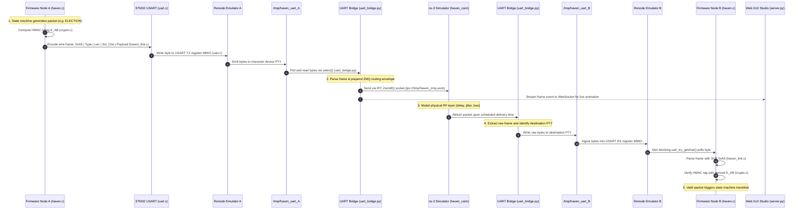

# HAVEN: Architecture & System Deep Dive Manual

---

## 1. High-Level System Architecture

HAVEN (**H**ardened **A**uthenticated **V**oter **E**lection **N**etwork) is an authenticated distributed max-consensus leader election protocol engineered specifically for resource-constrained, adversarial Wireless Sensor Networks (WSNs).

The architecture is founded on the principle of **"Perimeter Authentication"**: by enforcing strict symmetric authentication at the physical link boundary, malicious injections, forged scores, and replayed messages are discarded before they can influence the consensus state machine. This allows the distributed election to operate as a robust Crash-Fault-Tolerant (CFT) max-consensus system without requiring expensive Byzantine agreement protocols or public-key cryptography.

```
┌────────────────────────────────────────────────────────┐
│  Layer 3: Authenticated Max-Consensus Election        │
│  - Candidate draw, Priority pruning, Echo counting     │
│  - Claim window, Objection handling, Heartbeats        │
├────────────────────────────────────────────────────────┤
│  Layer 2: Node Authentication & Link Framing          │
│  - 3-way HELLO handshake, Session TTL, Neighbor Table  │
│  - Frame codec (SOF 0xA5, 5-byte header, CRC/HMAC)     │
├────────────────────────────────────────────────────────┤
│  Layer 1: Key Derivation (TurboBlom KDF)              │
│  - Pairwise key K_AB computation via shared spaces     │
│  - HMAC-SHA256 primitives, Master integrity tags       │
├────────────────────────────────────────────────────────┤
│  Layer 0: Deployment Provisioning (Offline Trusted)    │
│  - Node ID, Master Key (K_master), Space subsets, Batt │
└────────────────────────────────────────────────────────┘
```

---

## 2. End-to-End Simulation Message Flow ("Life of a Frame")

To understand the codebase, it is easiest to follow the lifecycle of a packet as it flows from a node's firmware through the emulation boundary, across the bridge, into the discrete-event RF network simulator, and back into a receiving node.



### Detailed Step-by-Step Flow:

1. **Transmission Decision in Firmware (`firmware/src/haven.c`)**:
   - The local state machine determines it needs to broadcast or send a message (e.g., a candidate claim).
   - It invokes `crypto.c` to generate authentication tags:
     - A link tag authenticated with pairwise key $K_{AB}$ (derived from shared TurboBlom spaces via `turboblom.c`).
     - An origin integrity tag authenticated with $K_{\text{master}}$ to prevent score tampering.
   - `haven_link.c` serializes the payload with a 5-byte header prefixed by Start-of-Frame delimiter `0xA5`:
     `[0xA5][Type][Length][Src_ID][Dst_ID][Payload][HMAC]`
   - `uart.c` writes the serialized frame byte-by-byte into the memory-mapped USART Transmit Data Register (`TDR`).

2. **Emulation Boundary (`renode/haven.repl` & `renode/haven.resc`)**:
   - Renode emulates an ARM Cortex-M3 core running at 16 MHz with an STM32F7 USART peripheral mapped at `0x40004400`.
   - The Renode initialization script attaches the emulated USART to a host Unix Pseudo-Terminal (PTY) device:
     `/tmp/haven_uart_<node_id>`

3. **Bridge Multiplexing (`bridge/uart_bridge.py`)**:
   - The Python bridge monitors all active `/tmp/haven_uart_*` PTY descriptors using non-blocking `select()`.
   - When bytes arrive, it reconstructs the frame using the `0xA5` delimiter, verifies length and structure, and prepends a 10-byte ZeroMQ routing envelope:
     `[u32 src_id][u32 dst_id][u16 len][raw_haven_frame]`
   - It publishes the message over an IPC ZeroMQ socket: `ipc:///tmp/haven_zmq.sock`.
   - Simultaneously, it emits packet flight metadata to the Web GUI server.

4. **Physical RF Modeling in ns-3 (`ns3/haven_csim.cc`)**:
   - The ns-3 application reads `topology.json` to construct the simulated RF topology.
   - Upon receiving a frame over ZeroMQ, it checks if an active physical link exists between the sender and destination (or all neighbors in case of broadcast `dst=0xFF`).
   - For valid links, it applies:
     - **Propagation & Transmission Delay**: Configurable per-hop latency (e.g., 20 ms).
     - **Stochastic Packet Loss**: Evaluates link quality and drops packets probabilistically.
   - ns-3 schedules an internal event for the simulated arrival timestamp. When the timer expires, it sends the packet back across the ZeroMQ socket to the bridge.

5. **Delivery to Destination Node**:
   - `bridge/uart_bridge.py` receives the packet from ns-3 and writes the raw `haven_link` frame directly into the destination node's PTY (`/tmp/haven_uart_<dst_id>`).
   - The receiving Renode instance places the bytes into the USART Receive Data Register (`RDR`).
   - The destination firmware's main polling loop calls `uart_try_getchar()`, feeds incoming bytes to `link_rx_consume()`, verifies the HMAC tag, and triggers the appropriate protocol event (`on_election`, `on_claim`, `on_heartbeat`).

6. **Web Telemetry & Visualizer (`gui/server.py`)**:
   - The GUI server receives telemetry over WebSockets and renders animated packets traveling between nodes, updates the real-time leader dashboard, and displays serial terminal logs.

---

## 3. Comprehensive Codebase Map & Directory Deep Dive

```
HAVEN/
├── firmware/          # Bare-metal C implementation for ARM Cortex-M3
├── renode/            # Renode hardware platform descriptions and launch scripts
├── bridge/            # PTY <-> ZeroMQ co-simulation bridge and virtual switch
├── ns3/               # ns-3 physical RF propagation and latency simulator
├── gui/               # Interactive Web Visualizer Studio & simulation engine
├── test_simulation/   # Python reference implementations and pytest suites
├── configs/           # Network topologies and simulation run configurations
│   ├── default_ring.conf
│   ├── topology_10node_ring.json
│   └── topology_20node_ring.json
├── scripts/           # Execution orchestrators and launch utilities
│   ├── start_gui.sh
│   └── start_haven.sh
├── docs/              # Protocol specifications, pseudocode, and technical manuals
└── requirements.txt   # Python dependencies and system-level toolchain requirements
```

---

### 3.1 `firmware/` — Embedded Bare-Metal C Core

The `firmware/` directory contains the complete C implementation of the HAVEN protocol, designed to compile directly for ARM Cortex-M3 microcontrollers without standard library dependencies.

#### Source Files (`firmware/src/`):
- **`main.c`**: Firmware entry point. Initializes hardware peripherals (SysTick timer, USART driver), initializes the link layer, provisions node credentials, and executes the non-blocking main polling loop (`haven_poll()`).
- **`haven.c`**: Core protocol state machine. Implements Phases 1 through 9 of the consensus protocol:
  - Neighbour discovery (`tx_discovery()`, `on_discovery()`).
  - Candidate draw and probability evaluation based on battery reserves.
  - Priority-pruned candidate propagation (`on_election()`).
  - Echo counting and resonance thresholding.
  - Claim timeout management ($T_{\text{claim}}$, $T_{\text{window}}$).
  - Leader promotion and periodic heartbeat transmission (`tx_heartbeat()`).
- **`turboblom.c`**: Implementation of the TurboBlom symmetric key derivation function (KDF). Finds overlapping key spaces between two nodes, computes sequential HMAC rows from $K_{\text{master}}$, XORs matching rows, and hashes the result with node IDs to produce a 16-byte pairwise key $K_{AB}$.
- **`haven_link.c`**: Link-layer framing and parsing engine. Implements a non-blocking streaming state machine that scans for Start-of-Frame delimiter `0xA5`, extracts the 5-byte header, collects payload bytes, and manages outgoing transmit queues.
- **`provision.c` & `node_config.c`**: Deterministic provisioning module. Assigns $k$ TurboBlom key spaces out of $m$ total spaces per node ID, provides initial battery levels, and supplies $K_{\text{master}}$.
- **`crypto.c`**: Thin wrapper around mbedTLS. Provides `haven_hmac()` using SHA-256 with zeroized stack buffers on error.
- **`uart.c`**: Raw memory-mapped I/O (MMIO) driver for the STM32F7 USART peripheral (`0x40004400`). Implements polled character transmission (`uart_putchar`) and non-blocking reception (`uart_try_getchar`).
- **`haven_time.c`**: Polled SysTick millisecond clock provider and anti-replay timestamp validation.
- **`startup.c`**: Minimal CRT0 startup code. Sets up the initial stack pointer (`_estack`), defines the reset handler, copies initialized data from Flash to SRAM, zeroes `.bss`, and transfers control to `main()`.

#### Header Files (`firmware/include/`):
- **`haven.h`**: Protocol state machine declarations, state enums (`M_DISCOVERY`, `M_ELECTION`, `M_PASSTHROUGH`, `M_CLAIMING`, `M_LEADER`), and message type codes.
- **`haven_config.h`**: Central compile-time tunables ($m=12, k=5, T_{\text{claim}}=5000\text{ms}, T_{\text{window}}=5000\text{ms}$, replay tolerances).
- **`haven_link.h`**: Link frame definitions, wire constants (`SOF = 0xA5`), and neighbor table struct definitions.
- **`turboblom.h`**: Cryptographic KDF API declarations.
- **`provision.h`**: Provisioning structures and table lookup definitions.
- **`crypto.h`**: HMAC and hash primitive declarations.
- **`uart.h`**: Hardware USART driver function prototypes.
- **`haven_time.h`**: System clock and timestamp API.
- **`mbedtls_config.h`**: Stripped mbedTLS configuration enabling only `MBEDTLS_MD_C` and `MBEDTLS_SHA256_C`.

#### Build Infrastructure:
- **`CMakeLists.txt`**: Cross-compilation specification targeting `arm-none-eabi-gcc` with `-mcpu=cortex-m3 -mthumb -nostartfiles --specs=nosys.specs`. Supports parameterized node provisioning via `-DNODE_ID=<id>`.
- **`linker.ld`**: Handcrafted linker script allocating 256 KB Flash (`0x00000000`) and 64 KB SRAM (`0x20000000`).
- **`build.sh`**: Helper shell script supporting clean rebuilds (`-c`) and quick QEMU execution (`-r`).
- **`mbedtls/`**: Git submodule tracking the official mbedTLS LTS release.

---

### 3.2 `renode/` — Hardware Emulation Platform

The `renode/` directory defines the simulated hardware environment executed by the Antmicro Renode framework:

- **`haven.repl`**: Renode platform definition written in Renode DSL. Defines:
  - An ARM Cortex-M3 CPU core.
  - Systick timer running at 16 MHz.
  - Flash memory region (256 KB at `0x00000000`).
  - SRAM memory region (64 KB at `0x20000000`).
  - An STM32F7 USART controller mapped at base address `0x40004400`.
- **`haven.resc`**: Renode script that instantiates the machine, loads the compiled `haven.elf` binary, binds the USART peripheral to a host Unix PTY (`/tmp/haven_uart`), and begins execution.

---

### 3.3 `bridge/` — Co-Simulation Interconnect

The `bridge/` directory contains host-side Python programs that connect individual emulated nodes into a unified network:

- **`uart_bridge.py`**: The primary production bridge. It attaches to the PTY endpoints created by Renode instances, packages raw serial frames into ZeroMQ datagrams with routing headers, and interfaces bidirectionally with ns-3.
- **`ring_switch.py`**: A fallback software router for testing without ns-3. It routes packets between adjacent nodes according to a pre-computed chordal ring order, enforcing simulated per-hop delays.
- **`tcp_test_server.py` & `uart_tcp_bridge.py`**: Early development utilities for single-node bring-up over raw TCP.

---

### 3.4 `ns3/` — Physical RF Network Simulator

The `ns3/` directory contains the discrete-event network simulator modeling the wireless RF physical medium:

- **`haven_csim.cc`**: C++ application linking ns-3 and `libzmq`. It:
  - Ingests `topology.json` to build the physical network graph.
  - Listens for frames from `uart_bridge.py` over ZeroMQ.
  - Models 802.15.4 packet propagation delay, channel contention, and signal fading/loss.
  - Delivers packets to destination node PTYs upon simulated arrival time.
- **`CMakeLists.txt`**: C++ build configuration to compile `haven_csim` against ns-3 libraries and ZeroMQ.

---

### 3.5 `gui/` — Interactive Web Visualizer Studio

The `gui/` directory provides a full-stack, browser-based control cockpit for the protocol:

- **`server.py`**: Asynchronous Python backend built on `aiohttp`. Hosts HTTP endpoints, serves static assets, provides a REST API to trigger simulation steps, and manages real-time WebSocket telemetry.
- **`haven_sim_engine.py`**: A high-fidelity, discrete-event protocol engine written in pure Python. Capable of running the complete 9-phase consensus protocol in memory, supporting continuous execution, stepping, and live fault injection (breaking links, crashing nodes, draining battery).
- **`index.html`**: The single-page dashboard containing network graphs, control panels, node inspectors, and packet chronicle logs.
- **`js/app.js` & `js/network_graph.js`**: Frontend JavaScript managing WebSocket connections, Vis.js force-directed network rendering, animated packet flights along canvas edges, and interactive node selection.
- **`css/styles.css`**: Modern dark-theme styling for the visualizer.

---

### 3.6 `test_simulation/` — Python Reference & Test Suites

The `test_simulation/` directory contains the algorithmic reference implementations and automated test suites:

- **`turboblom.py`**: Python reference implementation of the TurboBlom KDF and key generation functions.
- **`gen_topology.py`**: Graph generation tool creating valid `topology.json` files (Erdos-Renyi, Ring, Line, Star) with guaranteed connected components.
- **`compute_ring_order.py`**: Combinatorial solver that discovers valid Hamilton cycles ensuring adjacent nodes share at least one TurboBlom key space.
- **`network_sim.py`**: NetworkX-based resilience analysis modeling link compromise probabilities under node capture scenarios.
- **`tests/`**: Comprehensive `pytest` test suite:
  - `test_turboblom.py`: Mathematical symmetry tests ($K_{AB} == K_{BA}$) and known-answer vectors.
  - `test_provision.py`: Space assignment uniformity and battery distribution invariants.
  - `test_ring_election.py`: Multi-node election simulations asserting single-leader convergence.
  - `test_network_split_join.py`: Simulates graph partition and re-merge dynamics.
  - `test_topology.py`: Validates topology generator constraints.
  - `test_ring_switch.py`: Validates packet forwarding rules in the virtual switch.

---

### 3.7 `configs/` & `scripts/` — Simulation Orchestration & Topologies

- **`scripts/start_gui.sh`**: Launch script for the Web Visualizer Studio (spawns `gui/server.py` on port 8080).
- **`scripts/start_haven.sh`**: Orchestrator script for the full hardware co-simulation. Automatically cross-compiles individual node firmware binaries, starts ns-3, starts `uart_bridge.py`, and launches $N$ Renode instances with proper signal traps for clean shutdown.
- **`configs/default_ring.conf`**: Configuration parameters sourced by `start_haven.sh` (node counts, topology selections, timeout parameters).
- **`configs/topology_10node_ring.json`**: Primary 10-node network definition specifying coordinates, battery percentages, assigned key spaces, and physical links.
- **`configs/topology_20node_ring.json`**: Pre-configured 20-node topology for large-scale GUI demonstrations.
- **`requirements.txt`**: Python dependencies and system-level toolchain requirements.

