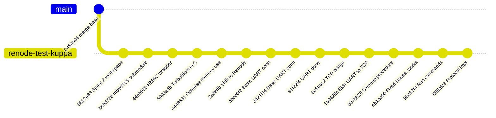
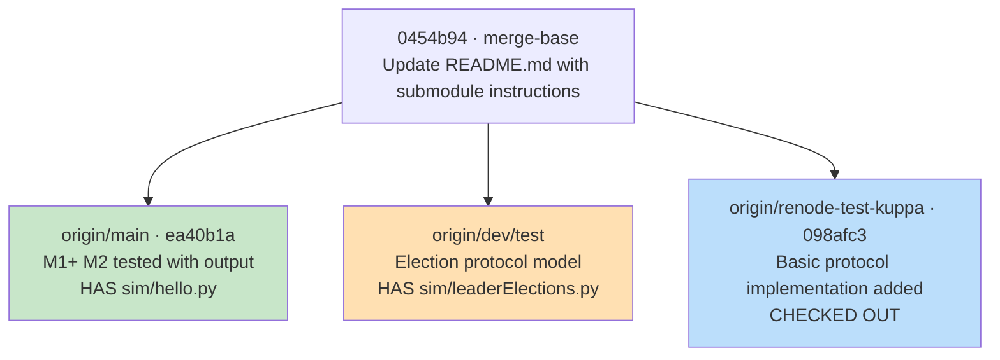
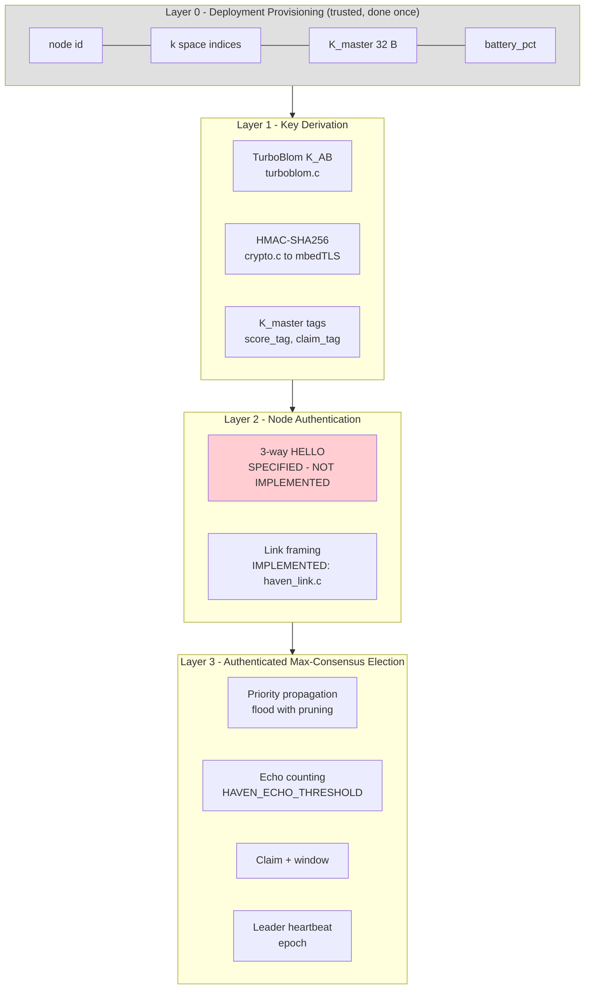
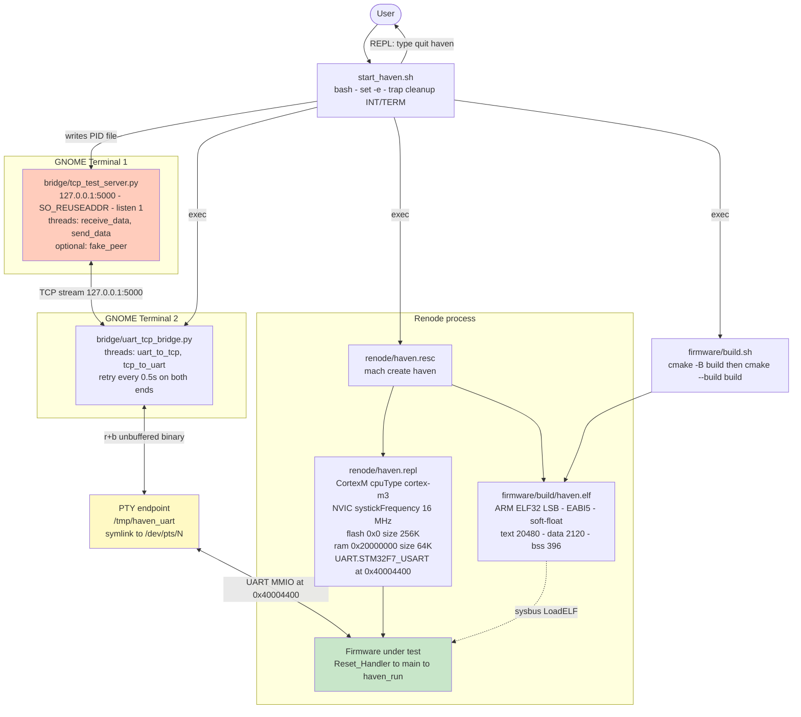
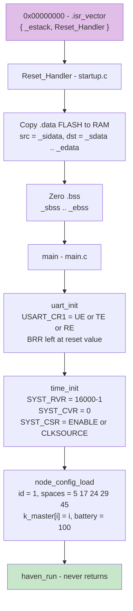
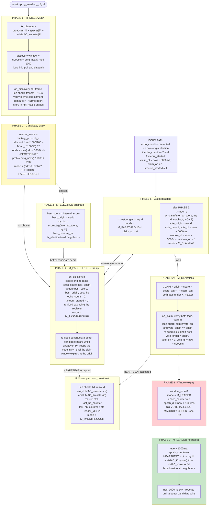
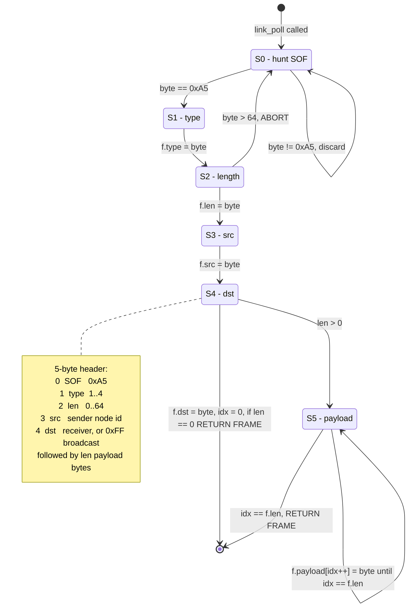
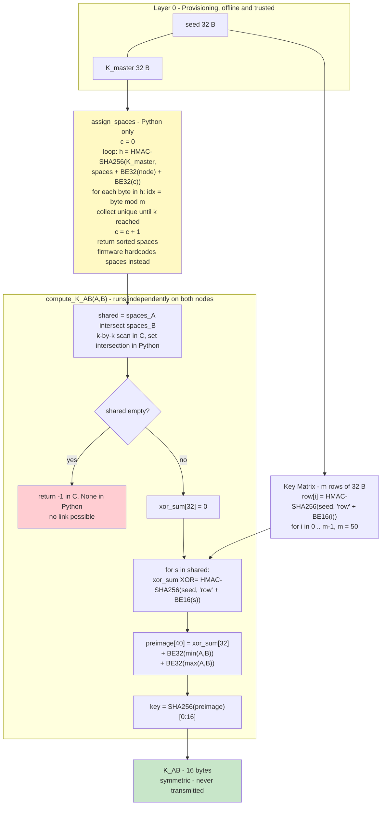
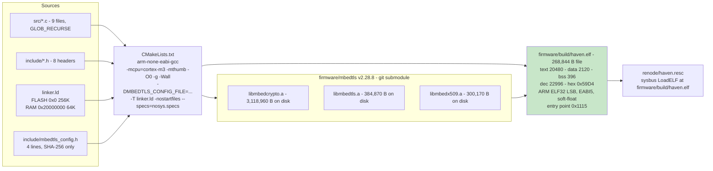

# HAVEN — Engineering Progress Report

**Project:** HAVEN — *Hardened Authenticated Voter Election Network*
**Report generated:** 2026-09-30
**Branch:** `renode-test-kuppa` (HEAD `098afc3` — *"Basic protocol implementation added"*)
**Scope:** all 33 git-tracked project files. `firmware/mbedtls` (submodule, v2.28.8) and `sim/.venv/` are treated as external dependencies and described at dependency level, not per file.
**Repository state:** clean except one uncommitted modification to `bridge/tcp_test_server.py` (documented in §7.5).

---

## Table of Contents

1. [Executive Summary](#1-executive-summary)
2. [Sprint History — What Was Done, Commit by Commit](#2-sprint-history--what-was-done-commit-by-commit)
3. [Architecture and Protocol Layering](#3-architecture-and-protocol-layering)
4. [Flow Charts](#4-flow-charts)
5. [Per-File Technical Deep Dive](#5-per-file-technical-deep-dive)
6. [Technical Reference Tables](#6-technical-reference-tables)
7. [Gaps, Bugs and Known Issues](#7-gaps-bugs-and-known-issues)
8. [Quick Reference — What Each File Does](#8-quick-reference--what-each-file-does)
9. [Ring Topology Implementation (Round 2)](#9-ring-topology-implementation-round-2)

---

## 1. Executive Summary

### 1.1 What the project is

HAVEN is a research-grade implementation of an **authenticated distributed max-consensus election protocol** for sparse, adversarial wireless sensor networks. The defining design constraint is **symmetric cryptography only** — no PKI, no public-key operations, no certificate infrastructure — because the target is ARM Cortex-M3 class hardware with tens of kilobytes of flash and nowhere to store a private key.

The core architectural insight is **authenticate at the perimeter**: if every message reaching the election layer has already been cryptographically attributed to a legitimate node, then the election problem collapses from Byzantine fault tolerance down to crash-fault-tolerant max-consensus, which is dramatically simpler.

### 1.2 Current status at a glance

| Layer | Component | Status | Evidence |
|---|---|---|---|
| **L0** | Deployment provisioning (id, spaces, K_master) | **Stub** | `firmware/src/node_config.c` hardcodes every value |
| **L1** | TurboBlom key pre-distribution | **Complete — Python and C** | `sim/turboblom.py`, `firmware/src/turboblom.c`; 3 pytest functions exist, **not executed for this review** |
| **L1** | Connectivity / capture-rate analysis | **Complete** | `sim/network_sim.py` — 42.34% sharing, sub-1% compromise vs Zhao |
| **L2** | 3-way HELLO node authentication | **Prototype only — NOT in firmware** | Exists as `sim/hello.py` on branch `main`; absent here |
| **L2** | Link-layer frame codec | **Complete** | `firmware/src/haven_link.c` — 5-byte header, SOF `0xA5` |
| **L3** | Authenticated max-consensus election | **Partial — see §7** | `firmware/src/haven.c` implements PHASE 1–9; vote tally missing |
| **Infra** | ARM cross-compile build | **Complete, not re-run here** | Pre-existing `firmware/build/haven.elf`, 22,996 B total; build flags read from generated `flags.make`/`link.txt`, but the build was **not re-executed** for this review |
| **Infra** | Renode emulation platform | **Complete** | `renode/haven.repl` — Cortex-M3 + 16 MHz SysTick + STM32F7 USART |
| **Infra** | UART ↔ TCP ↔ host bridge | **Complete** | `bridge/uart_tcp_bridge.py`, bidirectional, threaded |
| **Infra** | Host-side peer simulator | **Complete** | `bridge/tcp_test_server.py` — optional `HAVEN_FAKE_PEER` injection |
| **Infra** | One-command launcher | **Complete** | `start_haven.sh` — builds and launches all 3 processes with cleanup |
| **Docs** | Protocol design document | **Missing** | `README.md` references `docs/DESIGN.md`; directory does not exist |
| **Test** | Firmware automated tests | **None** | No C unit tests, no Renode robot tests, no protocol test vectors |

### 1.3 The three headline accomplishments

**1. A working, verifiable cryptographic core in two languages.**
The Python TurboBlom reference (`sim/turboblom.py`) and the C firmware implementation (`firmware/src/turboblom.c`) are **algorithmically identical** — same HMAC row derivation, same big-endian ID packing, same 40-byte preimage, same truncation to 16 bytes. This was established by reading both implementations line by line, *not* by executing them against each other. That is a weaker form of evidence than a passing test, and §7.10 recommends closing the gap with fixed known-answer vectors. It is still the strongest correctness signal available in the project, because the two implementations were written independently in different languages and still agree on every constant and every byte offset.

**2. A complete bare-metal bring-up chain.**
From `Reset_Handler` and a hand-written linker script, through a custom Renode platform, a polled SysTick, a raw MMIO UART driver, a byte-level framing layer, a PTY-backed UART↔TCP bridge, and finally a launcher that orchestrates all of it with proper cleanup. Fourteen commits took this from "no firmware" to "protocol exchanging authenticated frames over a simulated radio."

**3. The full protocol state machine, phase by phase.**
`firmware/src/haven.c` implements all nine phases of the max-consensus protocol — discovery, candidacy draw, priority propagation, echo counting, claim, window, and leader heartbeat — with dual-key authentication and constant-time MAC comparison.

### 1.4 The headline caveat

The protocol in `haven.c` is **not yet consensus-safe**. It correctly propagates and authenticates the winning candidate, but it **never counts votes** — after the claim window expires, the node unconditionally transitions to `M_LEADER`. The reference model it derives from (`sim/leaderElections.py` on branch `dev/test`) tallies votes and takes a majority. The firmware drops that step. This and eight other concrete findings are enumerated in [§7](#7-gaps-bugs-and-known-issues)

### 1.5 How to read this report

This is a **static review**. Everything below is derived from reading source, build artefacts, and Git history.

- **What was checked:** all 33 tracked project files, the pre-built `firmware/build/haven.elf` (sizes, sections, symbol table, entry point), the generated `flags.make` and `link.txt`, and the full commit history across `renode-test-kuppa`, `main`, and `dev/test`.
- **What was not run:** the firmware was **not** rebuilt, the pytest suites were **not** executed, `sim/network_sim.py` was **not** run, and nothing was launched under Renode. Claims about behaviour come from reading code, not from observing a run.
- **What is therefore unproven:** the cross-language agreement between the Python and C TurboBlom, the on-wire output of a real election, and whether the host bridge and fake peer actually interoperate. These are plausible from inspection but unconfirmed.

Where a statement is an inference rather than an observation, it is marked as such.

---
## 2. Sprint History — What Was Done, Commit by Commit

The working branch `renode-test-kuppa` diverges from `main` at merge-base `0454b94` and contains **14 commits** across four distinct phases of work.



### Phase A — Sprint 2 setup and cryptographic core (Jul 7 – Jul 13, 2026)

| Commit | Date | Author | What it delivered |
|---|---|---|---|
| `6812a83` | 2026-07-07 | Dev-023 | Branch and workspace setup for Sprint 2. |
| `bcbd728` | 2026-07-09 | PranavKuppa | Added mbedTLS as a git submodule at `firmware/mbedtls` (working tree pinned to **v2.28.8**). First supply-chain decision on the branch; a 4-line `mbedtls_config.h` was later added to compile a minimal SHA-256-only subset. |
| `44eb935` | 2026-07-09 | PranavKuppa | **HMAC wrapper.** Created `firmware/include/crypto.h` and `firmware/src/crypto.c` — one function, `haven_hmac()`, wrapping `mbedtls_md_hmac` with SHA-256, guaranteeing a 32-byte output and zeroing it on failure. This is the only crypto primitive exposed to the rest of the firmware. |
| `5993a4b` | 2026-07-13 | Dev-023 | **TurboBlom ported to C.** `firmware/src/turboblom.c` implements `compute_K_AB()` — the GF(2) variant of Blom's scheme: XOR the HMAC-derived key-matrix rows for all shared spaces, hash with the sorted node-ID pair mixed in, truncate to 16 bytes. |
| `a448631` | 2026-07-13 | Dev-023 | **Memory optimisation.** Refactored `compute_K_AB` to reuse two stack buffers (`xor_sum[32]`, `payload[40]`) across the row-XOR loop and the final hash, eliminating per-iteration allocation. Meaningful on a target with 64 KB of RAM. |

### Phase B — Emulation target migration (Aug 28, 2026)

| Commit | Date | Author | What it delivered |
|---|---|---|---|
| `2a3effb` | 2026-08-28 | PranavKuppa | **Shifted from QEMU to Renode.** The pivotal commit. Created `renode/haven.repl` — a hand-written platform with Cortex-M3, 16 MHz SysTick, 256 KB flash at `0x0`, 64 KB RAM at `0x20000000`, and an **STM32F7 USART at `0x40004400`**. The original QEMU target (`lm3s6965evb`) exposes a PL011 UART at `0x4000C000`, so `uart.c` was rewritten against the STM32 register map to match. The README's QEMU instructions were **not** updated and are now stale (§7.6). |

### Phase C — UART bring-up, host bridge, integration (Aug 30 – Sep 2, 2026)

| Commit | Date | Author | What it delivered |
|---|---|---|---|
| `abee0f2` | 2026-08-30 | PranavKuppa | First basic UART connection — `firmware/src/uart.c` with raw MMIO register access and polling. |
| `3421f14` | 2026-08-31 | PranavKuppa | Second pass on the basic UART connection. |
| `91f22f4` | 2026-08-31 | PranavKuppa | **UART done.** Full driver surface: `uart_putchar`, `uart_print`, `uart_getchar`, `uart_transmit`, `uart_receive`, and critically `uart_try_getchar` — the non-blocking variant the protocol layer depends on. |
| `6e5bac2` | 2026-09-01 | PranavKuppa | **TCP bridge.** `bridge/uart_tcp_bridge.py` opens Renode's PTY endpoint `/tmp/haven_uart` and bridges it to TCP `127.0.0.1:5000` with two threads for full duplex, plus retry loops for both device-not-found and connection-refused. |
| `1a9429c` | 2026-09-01 | PranavKuppa | **Completed bidirectional UART↔TCP communication.** Host-to-firmware and firmware-to-host paths both confirmed working. This unblocked the protocol work. |
| `007bb28` | 2026-09-02 | PranavKuppa | **Cleanup procedure.** Added signal traps and a `cleanup()` function to `start_haven.sh` so Ctrl-C or `quit haven` tears down all three child processes instead of orphaning them. |
| `eb1ae90` | 2026-09-02 | PranavKuppa | "Fixed issues and it all works" — integration fixes, chiefly around the launcher's process-discovery logic. |
| `96a37f4` | 2026-09-02 | PranavKuppa | **Run commands.** Added `run_commands.md`, a human-facing runbook covering first-time setup, full-system launch, and per-component manual testing including how to locate the PTY device. |

### Phase D — Protocol implementation (Sep 30, 2026)

| Commit | Date | Author | What it delivered |
|---|---|---|---|
| `098afc3` | 2026-09-30 | PranavKuppa | **"Basic protocol implementation added"** — the largest single commit, landing the entire Layer 1–3 protocol in `firmware/src/haven.c` (283 lines), plus `haven_link.c`, `haven_time.c`, `node_config.c`, the `haven_config.h` parameter block, `turboblom.h`, and the PTY terminal creation in `renode/haven.resc`. |

### 2.1 Branch topology and known divergence



Three divergence points matter for understanding the current state:

**1. `main` carries `sim/hello.py`** (commits `462e467`, `7a1d7f9`) — a working Python prototype of the **3-way HELLO** exchange, with `send_hello_req()` and `send_hello_resp()`, 16-byte nonces from `secrets.token_bytes`, `hmac.compare_digest` constant-time verification, and an explicit tamper test that flips one MAC byte and asserts rejection. This is exactly the Layer 2 authentication the firmware has **not** yet absorbed. It is absent from `renode-test-kuppa`.

**2. `dev/test` carries `sim/leaderElections.py`** (commits `cb55646`, `e20a105`, 219 lines) — a NetworkX + Matplotlib animated reference model of the election protocol, with `Node` and `ProtocolSimulation` classes and an `IDLE → ELECTING → LISTENING → VOTED → LEADER` state machine, animated over 80 frames. **This is the pseudocode that `firmware/src/haven.c` implements.** The `[CONFIRM]` and `[GAP]` comments scattered through `haven.c` are references back to this model — `echo_count` corresponds to `resonance_count`, `HAVEN_ECHO_THRESHOLD=2` to `RESONANCE_THRESHOLD=2`, and `HAVEN_T_CLAIM_MS=5000` to `TIMEOUT=5`. Critically, the model's final step — `max(set(votes), key=votes.count)`, a majority tally — has no counterpart in the firmware (§7.2).

**3. `main`'s `firmware/src/main.c` uses semihosting** (`bkpt 0xAB` with `SYS_WRITE0`, printing `"HAVEN boot"`). This branch replaced semihosting with the `UART.STM32F7_USART` PTY transport and left `renode/test_semihosting.repl` as a 1-line orphan fragment. `haven_config.h` explicitly disables printing with `HAVEN_LOG(...) ((void)0)` and the comment *"UART is the radio channel; don't print on it"* — a correct and important observation, since any log output would corrupt frames on the shared bus.

---
## 3. Architecture and Protocol Layering

### 3.1 The four layers

HAVEN is structured as a strict four-layer stack. Each layer receives input only from the layer below and has no knowledge of the layers above it.



**What this buys:** the election layer never handles a key, never verifies a MAC, and never parses a nonce. It trusts that anything arriving at `dispatch()` came from a node holding a provisioned `K_master` — that is, from the legitimate deployment. The problem it must solve is therefore crash-fault max-consensus, not Byzantine consensus.

### 3.2 The dual-key authentication model

A design detail worth calling out explicitly, because it is easy to miss when reading `haven.c`: **there are two distinct key tiers, and each protects a different class of field.**

| Key | Length | Scope | Used to authenticate |
|---|---|---|---|
| `K_master` | 32 B | Global secret, identical on every node | **Content integrity** — the *value* of a score, the identity of a claim origin, a heartbeat counter. Also derives the DISCOVERY space commitment. |
| `K_AB` | 16 B | Per-pair, derived independently by both endpoints, never transmitted | **Link attribution** — "this frame physically arrived from the neighbour I think it did", plus replay protection per link. |

Concretely, an `ELECTION` frame carries **two independent MACs** and the receiver verifies **both**:

```
ELEC_LEN = 2 (score) + 1 (origin) + 16 (score_tag) + 1 (replayer) + 4 (t) + 16 (hmac_replay)
                                 \__ HMAC(K_master, score||origin) __/
                                                              \__ HMAC(K_AB[replayer], score||origin||replayer||t) __/
```

This is a genuinely good design. An adversary who captures a node learns that node's `spaces` and `K_master`, which lets them forge *any* score — but they still cannot produce a valid `K_AB` link MAC for a link they are not physically on, so they cannot inject a *routed* election message. Conversely a passive eavesdropper sees link MACs they cannot verify or reuse elsewhere. Section 7.3 records where this model is **not** applied consistently.

### 3.3 Why UART is the radio

The test rig reuses the USART as the wireless medium. This is a deliberate and clever choice: `link_send()` writes a 5-byte header plus payload to a UART, and every node on the "bus" receives those bytes, giving multi-node broadcast behaviour with zero additional infrastructure. `HAVEN_ID_NONE = 0xFF` doubles as the broadcast address, and `dispatch()` accepts any frame addressed to itself or to `0xFF`.

The cost is that the transport is **fully trusted** — the host bridge can inject arbitrary bytes at any offset, and the firmware has no way to distinguish a real neighbour from the test harness. That is acceptable for bring-up, and it is why the test server has a `hex:` raw-injection mode (§7.5).

---
## 4. Flow Charts

### 4.1 End-to-end runtime topology

This is the full system as launched by `./start_haven.sh`. Three long-lived processes, two of which are launched inside GNOME terminal windows so their interactive stdin/stdout stay usable.



**Launch ordering** — each step depends on the previous, so the sequence matters:

1. `rm -f /tmp/haven_server.pid /tmp/haven_bridge.pid` — clear stale PID files from a previous crashed run.
2. Build firmware by delegating to `firmware/build.sh`.
3. Launch the TCP server in terminal 1; **poll** at 0.1 s intervals until `/tmp/haven_server.pid` appears.
4. Launch Renode with `renode/haven.resc`; `sleep 1`; discover the Renode PID with `pgrep -n -f "dotnet /opt/renode/bin/Renode.dll .../haven.resc"`.
5. Launch the bridge in terminal 2; **poll** until `/tmp/haven_bridge.pid` appears.
6. Enter a blocking `read` loop; on the literal string `quit haven`, run `cleanup()` and exit 0.

**Shutdown** — `cleanup()` kills `$RENODE_PID`, `$SERVER_PID`, `$BRIDGE_PID`, each guarded with `2>/dev/null || true` so an already-dead process is not an error, wired to `trap cleanup INT TERM`.

### 4.2 Firmware boot sequence



There is no interrupt vector table beyond those two initial entries — no `SysTick_Handler`, no IRQ stubs. Everything is polled, a deliberate simplification for a bare-metal bring-up.

### 4.3 Protocol phase state machine (`haven_run`)

This is the core algorithm. Mode transitions run `M_DISCOVERY` → `M_ELECTION` → `M_PASSTHROUGH` → `M_CLAIMING` → `M_LEADER`.



### 4.4 Link frame codec state machine

`firmware/src/haven_link.c` implements a byte-oriented, stateful parser. This is what makes the raw UART usable as a datagram radio.



**Key properties:**

- **Non-blocking.** `link_poll` drains whatever bytes are available via `uart_try_getchar` and returns `0` if no complete frame is buffered. Parser state (`st`, `idx`, `f`) is `static`, so it survives across calls — mandatory, because the caller polls in a tight loop and a frame will almost never arrive in a single call.
- **Self-synchronising.** Once in S0, any non-SOF byte is discarded. The SOF byte is consumed as a delimiter, so a payload byte equal to `0xA5` is safe as long as the preceding length byte is correct.
- **Bounded.** `len` is rejected if `> 64`, exactly matching `payload[HAVEN_MAX_PAYLOAD]`. `len == 64` is legal and fills the buffer exactly — no off-by-one overflow.
- **Zero-length frames** are supported and returned immediately from S4 without entering S5.

`dispatch()` then gates on destination: frames addressed to another node, or to a non-broadcast ID, are silently dropped.

### 4.5 TurboBlom key derivation

The GF(2) variant of Blom's scheme, implemented identically in Python and C.



**Why this construction is correct and safe:**

- **Symmetric.** The preimage uses `min` and `max` of the two IDs, so both nodes compute an identical key with no coordination. XOR is commutative, so traversal order is irrelevant too. The pytest suite explicitly asserts `key_ab == key_ba`.
- **Per-pair unique.** The sorted ID pair mixed into the preimage means the same shared-space set yields different keys for different pairs, defeating key-reuse across links.
- **Never transmitted.** The key is *derived*, not distributed — the entire point of the pre-distribution scheme. Capturing a node yields only that node's row subset.
- **Blom's threshold property.** Compromise requires `lambda + 1 = 4` captured nodes to share a space, not just one. `network_sim.py` quantifies this at **0.046%** link compromise under 10% node capture.

### 4.6 Build pipeline



**Final section layout, as measured from the real artifact with `arm-none-eabi-objdump -h`:**

| Section | VMA | LMA | Size | Notes |
|---|---|---|---|---|
| `.isr_vector` | `0x00000000` | `0x00000000` | 8 B | Two entries: stack pointer and `Reset_Handler` |
| `.text` | `0x00000008` | `0x00000008` | 20,160 B | All code |
| `.rodata` | `0x00004EC8` | `0x00004EC8` | 312 B | String literals and const tables |
| `.data` | `0x20000000` | `0x00005000` | 2,120 B | Initialised; mbedTLS SHA-256 constant tables dominate |
| `.bss` | `0x20000848` | — | 396 B | All HAVEN protocol state |

**Flash budget: 22,600 of 262,144 B = 8.6% used** (8 vector + 20,160 text + 312 rodata + 2,120 data image). **RAM budget: 2,516 of 65,536 B = 3.8% used.** The protocol has enormous headroom on this part.

**`.text` breakdown — SHA-256 dominates:**

| Symbol | Size (B) | Share of `.text` |
|---|---|---|
| `mbedtls_internal_sha256_process` | 8,088 | 40.1% |
| `_malloc_r` (newlib) | 1,356 | 6.7% |
| `mbedtls_sha256_finish_ret` | 724 | 3.6% |
| `strcmp` (newlib, unused by this project) | 442 | 2.2% |
| `mbedtls_md_hmac_starts` | 332 | 1.6% |
| `mbedtls_sha256_update_ret` | 240 | 1.2% |
| `memcpy` | 236 | 1.2% |
| `mbedtls_sha256_starts_ret` | 208 | 1.0% |
| `on_election` | 408 | 2.0% |
| **`haven_run` — all protocol logic** | **792** | **3.9%** |
| `compute_K_AB` | 362 | 1.8% |
| `link_poll` | 280 | 1.4% |
| `on_discovery` | 272 | 1.3% |
| `tx_election` | 268 | 1.3% |
| `on_claim` | 240 | 1.2% |
| `tx_claim` | 184 | 0.9% |
| `on_heartbeat` | 188 | 0.9% |
| `tx_heartbeat` | 188 | 0.9% |
| `Reset_Handler` | 96 | 0.5% |
| `haven_hmac` | 86 | 0.4% |
| `time_ms` | 48 | 0.2% |
| `time_init` | 44 | 0.2% |
| `main` | 26 | 0.1% |
| `uart_init` | 24 | 0.1% |

The single largest lever for further size reduction is obvious: SHA-256 accounts for 40% of `.text` and 36% of the whole image. Swapping to a smaller MAC — ASCON-MAC, as the README itself suggests for tighter targets — would remove `mbedtls_internal_sha256_process` outright and cut roughly a third off the code section.

---
## 5. Per-File Technical Deep Dive

### 5.1 `firmware/src/haven.c` — the protocol (283 lines)

The heart of the implementation: nine phases, four message handlers, four transmit functions, and the entire timing and deadline machinery.

#### State variables

| Variable | Type | Role |
|---|---|---|
| `mode` | `hv_mode` | Current protocol mode |
| `internal_score` | `uint16_t` | `battery_pct + nb_n` — this node's own priority |
| `best_score`, `best_origin` | `uint16_t`, `uint8_t` | Best (score, origin) pair seen so far |
| `best_hs`, `my_hs` | `uint8_t[16]` each | `K_master`-authenticated proofs of `best_score`/`best_origin` and of this node's own score |
| `echo_count` | `uint8_t` | Times this node has heard its own claim echoed back |
| `timeout_started` | `uint8_t` | One-shot guard so the claim timer cannot be re-armed |
| `claim_dl`, `window_dl`, `vote_dl`, `epoch_dl` | `uint32_t` | Absolute millisecond deadlines |
| `claim_on`, `window_on`, `vote_on` | `uint8_t` | Armed flags for the three timers |
| `vote_origin` | `uint8_t` | Origin this node has already forwarded a vote for |
| `epoch_counter`, `last_hb_counter` | `uint32_t` | Monotonic local and last-seen heartbeat counters |
| `leader_id` | `uint8_t` | Current known leader, initialised to `HAVEN_ID_NONE` |
| `nb[8]`, `nb_n` | `nbr_t[8]`, `uint8_t` | Neighbour table, each entry `{id, K_AB[16]}` |
| `prng_seed` | `uint64_t` | LCG state |
| `g_cfg` | `node_config_t` | Global node configuration, defined here, populated by `node_config.c` |

#### Message lengths

```c
#define TAG      HAVEN_TAG_LEN                        // 16
#define ELEC_LEN  (2 + 1 + TAG + 1 + 4 + TAG)          // 40
#define CLAIM_LEN (1 + 2 + TAG + 4 + TAG)              // 39
#define HB_LEN    (4 + 1 + TAG + TAG)                  // 37
#define DISC_LEN  (1 + HAVEN_NUM_SPACES + 4 + HAVEN_HASH_LEN)  // 18
```

All four fit comfortably inside `HAVEN_MAX_PAYLOAD = 64`; the largest is `ELEC_LEN` at 40 bytes payload, 45 bytes on the wire with the header.

#### Helper layer

- **`put16` / `get16` / `put32` / `get32`** — hand-rolled **little-endian** serialisation. Deliberately not `memcpy` of a native integer, so the wire format is identical on little- and big-endian builds. `get32` casts the top byte to `uint32_t` before shifting, avoiding sign extension on the high bit.
- **`now_s()`** — `time_ms() / 1000`, the coarse timestamp embedded in message payloads.
- **`expired(dl)`** — `(int32_t)(time_ms() - dl) >= 0`. Signed-difference deadline comparison, which is **wrap-safe** across the 32-bit millisecond rollover at roughly 49.7 days. This is the correct idiom, and getting it wrong is a classic bare-metal bug.
- **`fresh(t)`** — accepts timestamps within `±HAVEN_REPLAY_WINDOW_S` (10 s) of now, using the same signed-difference technique. This is the only replay defence at the protocol level.
- **`tag()`** — calls `haven_hmac()` into a 32-byte `full` buffer, then `memcpy`s the first `TAG = 16` bytes. Truncation, not a second primitive.
- **`tag_ok()`** — the security-critical helper. Accumulates `d |= t[i] ^ rx[i]` across all 16 bytes and returns `d == 0`: **constant-time with respect to MAC contents**, with no early exit on the first mismatching byte. The extra `nz |= t[i]` term is a subtle and genuinely correct guard — `haven_hmac` zeroes its output on internal failure, so an all-zero expected tag would otherwise match an all-zero received tag. Requiring `nz != 0` closes that forgery path. This is better practice than most embedded HMAC verification code.
- **`nb_find(id)`** — linear scan over the neighbour table; returns a pointer or `0`.
- **`score_tag` / `score_tag_ok`** — `HMAC(K_master, BE16(score) ‖ origin)` over a 3-byte message. Used in `ELECTION`, `CLAIM`, and when computing `my_hs`. The `[CONFIRM key/input]` comment marks this as verified against the pseudocode.
- **`prng_next()`** — LCG `(A·seed + B) mod 2^32` with `A = 1664525`, `B = 1013904223` (the Numerical Recipes constants), stored in a `uint64_t` so the intermediate product cannot overflow, then truncated to `uint32_t` on return.

#### PHASE 1 — Discovery

`tx_discovery()` broadcasts to `HAVEN_ID_NONE` (`0xFF`):

```
offset  size  field                              protection
  0      1    my node id                         (cleartext)
  1      5    my space indices                   (cleartext)
  6      4    timestamp, little-endian           (cleartext, freshness-checked)
 10      8    commitment = HMAC_Kmaster(p[0..9])[0:8]   HAVEN_HASH_LEN = 8
                                                  total DISC_LEN = 18
```

`discovery_hash()` builds a 10-byte message `m[1 + 5 + 4]`, `memcpy`s `sizeof m` bytes from the body, HMACs it under `K_master`, and copies out 8 bytes. The commitment binds id, spaces and timestamp together, so a third party cannot alter the advertised space set without detection — **but anyone who knows `K_master` can**, and `K_master` is shared by every node (§7.3).

`on_discovery()` is defensively written, with four independent rejection conditions:

1. Exact length check `f->len != DISC_LEN` → return.
2. Freshness check on the embedded timestamp.
3. Recompute the 8-byte commitment and `memcmp` against the received one.
4. Reject if `peer == g_cfg.id` (ignore our own broadcast).

On success it calls `compute_K_AB(g_cfg.id, peer, k_master, our_spaces, their_spaces, k, k_buf)` and stores or refreshes the neighbour entry. **New or existing:** if `nb_find(peer)` returns `0` and the table is full (`nb_n >= 8`), the peer is silently dropped. An existing entry is **overwritten** with the newly derived key — the entry is never aged, never expires, and there is no `HELLO` re-verification.

#### PHASE 3/4 — Election propagation

`tx_election(score, origin, hs, exclude)` iterates the neighbour table, skipping `exclude`, and builds a **40-byte** payload containing **two** MACs:

```
offset  size  field
  0      2    score, LE
  2      1    origin node id
  3     16    score_tag = HMAC_K_master(score || origin)      <- content integrity
 19      1    replayer id (who actually sent this frame)
 20      4    timestamp, LE
 24     16    hmac_replay = HMAC(K_AB[neighbour], score||origin||replayer||t)
                                                  <- link attribution + replay
                                                  total ELEC_LEN = 40
```

The link MAC is computed over an 8-byte message `m[8]`: `BE16(score) ‖ origin ‖ replayer ‖ LE32(t)`. It is computed with the **recipient's** `K_AB`, so only the intended recipient and the sender (who derived the same key) can produce it.

`on_election()` verifies, in order:

1. Exact length `ELEC_LEN`.
2. `fresh(t)`.
3. `nb_find(replayer)` — reject if the replayer is not a known neighbour. This means an election frame from an unknown node is dropped outright.
4. `tag_ok(n->key, ...)` on the 8-byte link MAC. **This implicitly verifies `f->src` equals `replayer`.**
5. `score_tag_ok(score, origin, p+3)` on the `K_master` content MAC.

Then two branches:

- **Own-origin echo** — `origin == g_cfg.id`: increments `echo_count`, and if `echo_count >= 2` and `!timeout_started`, arms `claim_dl = time_ms() + 5000` and sets `claim_on = 1`, `timeout_started = 1`. This is the "my claim reached enough of the network" signal.
- **Better candidate** — if `(score, origin)` beats `(best_score, best_origin)` lexicographically by score then by higher origin ID as tiebreak: update best, **reset `echo_count` and `timeout_started`**, re-flood excluding the replayer, and if still in `M_ELECTION` drop to `M_PASSTHROUGH`. The tiebreak on higher origin ID gives a deterministic total order, which is what makes convergence possible.

The `echo_count` reset on any better candidate is important: a node that hears a better claim abandons its own candidacy entirely and restarts the echo count for the new winner.

#### PHASE 6/7 — Claim

`claim_tag(origin, t)` is `HMAC(K_master, origin ‖ LE32(t))` over 5 bytes. `CLAIM_LEN = 39`:

```
offset  size  field
  0      1    origin node id
  1      2    score, LE
  3     16    score_tag = HMAC(K_master, score || origin)
 19      4    timestamp, LE
 23     16    claim_tag = HMAC(K_master, origin || t)
                                                  total CLAIM_LEN = 39
```

`on_claim()` verifies length, `fresh(t)`, then **both** `K_master` tags. It then applies the loop guard `[GAP]` — `if (vote_on && vote_origin == origin) return` — re-floods the claim excluding `f->src`, and records `vote_origin = origin`, `vote_on = 1`, `vote_dl = time_ms() + 5000`.

That loop guard is marked `[GAP]` in the source: it is **not** in the pseudocode, it was added defensively, and it is a **partial** mitigation. Because `vote_on` is cleared once `vote_dl` expires, a two-node topology can ping-pong the same claim back and forth for the full 5-second window, and across a larger topology the claim can keep circulating until the 10-second `fresh()` window rejects it (§7.4).

Crucially, the claim is authenticated **only by `K_master`** — there is no `K_AB` link MAC, unlike `ELECTION` (§7.3).

#### PHASE 9 — Heartbeat

`HB_LEN = 37`: `LE32(counter) ‖ leader_id ‖ HMAC_K_master(counter)[0:16] ‖ HMAC_K_master(leader_id)[0:16]`.

`on_heartbeat()` rejects its own ID, verifies both `K_master` tags, and then enforces `ctr <= last_hb_counter → return`. This monotonic-counter check is the anti-replay mechanism, and the `[CONFIRM]` comment marks it as verified against the pseudocode's "counter freshness" requirement. On acceptance it records `last_hb_counter`, `leader_id`, and sets `mode = M_PASSTHROUGH`.

`tx_heartbeat()` increments `epoch_counter` (starting from 0, so the first beat is 1) and broadcasts. Both the counter and the leader ID are separately MAC'd, so neither can be altered independently.

#### `haven_run()` — the main loop

```c
prng_seed = g_cfg.id;                                // [CONFIRM] initial_random_seed()
tx_discovery();
uint32_t end = time_ms() + 5000u + (prng_next() % 1000u);   // 5 < x < 6 s
while (!expired(end)) if (link_poll(&f)) dispatch(&f);

internal_score = g_cfg.battery_pct + nb_n;
uint32_t odds = (((uint32_t)HAVEN_L_WEIGHT * g_cfg.battery_pct * 1000u) / 100u +
                 ((uint32_t)HAVEN_M_WEIGHT * nb_n * 1000u) / HAVEN_MAX_ADJ_NODES) / 2u;
if (odds < 1000u) odds = 1000u;
uint32_t prob = (uint32_t)(((uint64_t)prng_next() * 1000u) / HAVEN_PRNG_M);
mode = (odds > prob) ? M_ELECTION : M_PASSTHROUGH;
```

The three-phase structure is: a **timed** discovery window with a randomised jitter, then a single candidacy draw, then an **untimed** `for (;;)` servicing loop. The jitter is `prng_next() % 1000`, so the window is 5.000–5.999 s.

The final loop checks four conditions in order each iteration: claim deadline expiry, window expiry, vote timer expiry, and — only if `mode == M_LEADER` — epoch expiry. Note the ordering: `claim_dl` is evaluated before `window_dl`, so a leader re-arms its own epoch timer on every window expiry.

The `odds` formula is **provably degenerate** and is analysed in detail in §7.1.

### 5.2 `firmware/src/haven_link.c` — framing layer (29 lines)

Two functions, both `static`-free, both thin. This is the Layer 2 transport.

`link_send(dst, type, p, len)` builds a 5-byte header `{SOF, type, len, g_cfg.id, dst}` and calls `uart_transmit` twice — once for the header, once for the payload. There is no buffering, no flow control and no return value: the caller cannot know whether the frame was delivered. Since `HAVEN_MAX_PAYLOAD` is 64 and all protocol frames are 18–40 bytes, a caller-side bounds violation is possible but currently does not occur.

`link_poll(out)` is the stateful parser described in §4.4. Two implementation details worth noting:

- `static uint8_t st, idx; static frame_t f;` — parser state is function-static. This is correct for the polling design and required, since state must survive across calls.
- The length check in state 2 is `if (b > HAVEN_MAX_PAYLOAD)` — **strictly greater**, so `len == 64` is accepted and exactly fills `payload[64]`. The bounds are correct.

`f.len` is a `uint8_t`, so a length byte of `0xFF` is caught by the `> 64` check and resets the parser to state 0, resynchronising on the next SOF. That is a well-behaved recovery path.

### 5.3 `firmware/src/haven_time.c` — polled millisecond clock (21 lines)

Direct SysTick register access at the ARMv7-M architectural addresses:

| Register | Address | Use |
|---|---|---|
| `SYST_CSR` | `0xE000E010` | Control/status; `COUNTFLAG` at bit 16 |
| `SYST_RVR` | `0xE000E014` | Reload value |
| `SYST_CVR` | `0xE000E018` | Current value |

`time_init()` sets `RVR = 16000000/1000 - 1 = 15999` — one millisecond at the 16 MHz clock the Renode platform declares — zeroes `CVR`, and enables with `CLKSOURCE` set so the **processor** clock (not the external reference) drives the counter.

`time_ms()` relies on the fact that **reading `SYST_CSR` clears `COUNTFLAG`**: if the flag is set, increment the static `ms` and return it. This is a polled tick with no interrupt, and `haven_time.h` documents the contract explicitly: *"must be called more often than every 1 ms of sim time"*.

That contract is a real design trade-off. `COUNTFLAG` is a single sticky bit, so **N missed milliseconds collapse into one tick**. Any blocking operation longer than 1 ms therefore corrupts the clock. The current code never blocks for long — `uart_putchar` spins on `TXE`, which in Renode is effectively always ready — but this is the most fragile timing assumption in the firmware (§7.5).

The static `ms` counter starts at 0, so `time_ms()` is 0 at boot. The first DISCOVERY timestamp of 0 combined with `fresh()` works because `d = 0 - 0 = 0` is within the window.

### 5.4 `firmware/src/uart.c` — STM32F7 USART driver (90 lines)

Raw MMIO against the STM32 USART register block. **The base address and register layout match the Renode platform exactly**, which is what makes the bring-up work.

```c
#define UART_BASE 0x40004400UL      // matches renode/haven.repl: UART.STM32F7_USART @ 0x40004400
#define USART_CR1 (*(volatile uint32_t *)(UART_BASE + 0x00))
#define USART_BRR (*(volatile uint32_t *)(UART_BASE + 0x0C))
#define USART_ISR (*(volatile uint32_t *)(UART_BASE + 0x1C))
#define USART_TDR (*(volatile uint32_t *)(UART_BASE + 0x28))
#define USART_RDR (*(volatile uint32_t *)(UART_BASE + 0x24))
```

Every register is `volatile` and cast from an absolute address, so the compiler cannot elide or reorder the accesses. No HAL, no CMSIS, no vendor headers — the whole driver is 90 lines.

`uart_init()` writes `USART_CR1 = UE | TE | RE` (bits 0, 3, 2) and **deliberately leaves `BRR` at its reset value**, with a comment saying so. On real hardware this would mean the baud rate is whatever the reset default is, and the host end would need to be configured to match — or the link would not work at all. In Renode the UART model is tolerant, so the omission is invisible here. It is a latent portability bug (§7.6).

The four polling bits are correct for the STM32 family: `TXE_TXFNF` at ISR bit 7, `RXNE_RXFNE` at ISR bit 5.

| Function | Blocking? | Behaviour |
|---|---|---|
| `uart_putchar` | Yes | Spins until `TXE`, then writes `TDR`. |
| `uart_print` | Yes | Loops `uart_putchar` over a NUL-terminated string. **Dead code** — no caller. |
| `uart_getchar` | Yes | Spins until `RXNE`, returns `(char)RDR`. Only called by `uart_receive`. |
| `uart_transmit` | Yes | Byte-at-a-time `uart_putchar` loop. No FIFO exploitation. |
| `uart_receive` | Yes | Reads until `\n` or `max_len-1`, strips `\r`, NUL-terminates, returns length. **Dead code** — no caller. |
| `uart_try_getchar` | **No** | Returns 1 and reads `RDR` if `RXNE` is set, else returns 0 immediately. **This is the one the protocol uses.** |

`uart_try_getchar` is the linchpin: `link_poll` is built entirely on it, which is what allows `haven_run`'s main loop to be non-blocking. `uart_transmit` being byte-at-a-time and blocking is acceptable given frames are at most 45 bytes.

Two functions, `uart_print` and `uart_receive`, are compiled in but unreachable — together 126 bytes, or 0.62% of `.text` — and can be removed, or kept as a human debug interface via a build flag.

### 5.5 `firmware/src/turboblom.c` — TurboBlom in C (71 lines)

`compute_K_AB(node_a, node_b, seed, spaces_a, spaces_b, k, out_key)` is the C mirror of the Python reference. The `a448631` commit's memory optimisation is visible in the comments: two buffers are declared once at function scope and reused for every role.

```c
uint8_t xor_sum[32];    // XOR accumulator, later reused as the SHA-256 output buffer
uint8_t payload[40];    // row-HMAC scratch, later the 40-byte final preimage
```

The nested `k × k` loop compares `spaces_a[i] == spaces_b[j]`. On a match it builds a 5-byte message:

```c
uint8_t msg[5] = { 'r', 'o', 'w',
                   (spaces_a[i] >> 8) & 0xFF,   // always 0: uint8_t promoted to int
                   spaces_a[i] & 0xFF };
```

This is **exactly** the Python `b'row' + i.to_bytes(2, 'big')`. The `>> 8` term is a no-op for a `uint8_t` promoted to `int` — it exists to mirror the 2-byte big-endian encoding, and it is harmless because all space indices are `< 50`.

`haven_hmac(seed, 32, msg, 5, payload)` produces the 32-byte row, which is XORed into `xor_sum`. A `shared_count` counter is incremented; `if (shared_count == 0) return -1` is the no-shared-space failure path that `on_discovery` checks.

The final step reuses both buffers: `payload` is refilled with `xor_sum[0..31]` followed by the two IDs as 4-byte big-endian values (`id_low` at 32–35, `id_high` at 36–39), then `mbedtls_sha256_ret(payload, 40, xor_sum, 0)` writes the digest back into the now-redundant `xor_sum`, and `memcpy(out_key, xor_sum, 16)` truncates.

`id_low`/`id_high` are computed by comparing the two IDs, giving the **symmetry** property. The 40-byte preimage layout is identical to the Python `xor_sum + id_low.to_bytes(4,'big') + id_high.to_bytes(4,'big')`.

Note the function calls `mbedtls_sha256_ret` **directly** rather than going through `haven_hmac`, which is correct: this is a bare hash, not a MAC. The `0` fourth argument is `is224 = 0`, selecting SHA-256 over SHA-224.

### 5.6 `firmware/src/crypto.c` — the only crypto surface (22 lines)

`haven_hmac(key, key_len, msg, msg_len, out)` wraps `mbedtls_md_hmac` with a `mbedtls_md_info_t` obtained from `mbedtls_md_info_from_type(MBEDTLS_MD_SHA256)`.

Two failure paths both `memset(out, 0, 32)` and return:
- `md_info == NULL` — the SHA-256 module was not compiled in.
- `mbedtls_md_hmac` returned non-zero.

Zeroing on failure is the right call, and it interacts correctly with `tag_ok`'s `nz` guard (§5.1): a zeroed output can never be accepted as a valid tag. This is defence in depth done properly.

The key lengths used are 32 (`K_master`) and 16 (`K_AB`), both well within SHA-256's 64-byte block-key limit. `mbedtls_md_hmac` in v2.28 allocates its context on the stack, so **no heap is used** by the crypto path — important for a bare-metal target, and consistent with `mbedtls_config.h` defining `MBEDTLS_NO_PLATFORM_ENTROPY`.

The `mbedtls_md_hmac` signature is deprecated in mbedTLS 3.x. On v2.28.8 it is correct, but a future submodule bump will break this file.

### 5.7 `firmware/src/node_config.c` — Layer 0 stub (10 lines)

```c
g_cfg.id = 1;
static const uint8_t spaces[HAVEN_NUM_SPACES] = {5, 17, 24, 29, 45};
for (int i = 0; i < HAVEN_NUM_SPACES; i++) g_cfg.spaces[i] = spaces[i];
for (int i = 0; i < 32; i++) g_cfg.k_master[i] = (uint8_t)i;
g_cfg.battery_pct = 100;
```

Everything is hardcoded, and the `TODO` comments say so. Two things are worth understanding rather than just noting:

- **`k_master[i] = i` is exactly `bytes(range(32))`.** That is the same value as the fake peer's `K = bytes(range(32))` in `bridge/tcp_test_server.py`, which is precisely what makes the fake-peer DISCOVERY commitment verify and lets node 1 derive a real `K_AB` for peer 2. Note it does **not** match `sim/network_sim.py`'s `K_MASTER = bytes(range(32, 64))` or `sim/turboblom.py`'s self-test `K_master = bytes(range(32, 64))` — the firmware and the simulation use different master keys. The firmware-to-fake-peer coupling that makes the test rig work is undocumented and brittle: change the firmware's key and the host peer silently stops authenticating.
- **`spaces = {5, 17, 24, 29, 45}` shares exactly one space, `24`, with the fake peer's `{7, 10, 19, 24, 37}`.** So `compute_K_AB` succeeds with `shared_count == 1` and node 1 stores a real `K_AB` for peer 2. The test rig was deliberately configured to make the minimum viable key derivation succeed.

There is no battery sensor, no provisioning transport, and no per-node differentiation — this ELF is a single node with id 1 (§7.5).

### 5.8 `firmware/src/main.c` — entry point (13 lines)

```c
int main(void) {
    uart_init();
    time_init();
    node_config_load();   /* you implement: id, spaces, K_master, battery */
    haven_run();
    return 0;
}
```

Four calls, strictly ordered: the clock must exist before provisioning timestamps are meaningful, and `haven_run` never returns so the `return 0` is unreachable. Compiles to 26 bytes.

### 5.9 `firmware/src/startup.c` — reset handler and vector table (47 lines)

The entire boot path. This is inherited from the `qemu-bringup` work on `main` and is the only file on this branch not touched by the protocol commit.

```c
__attribute__((section(".isr_vector")))
void(*const vector_table[])(void) = {
    (void(*)(void))& _estack,
    Reset_Handler
};
```

Two entries: the initial stack pointer, then the reset handler. The `const` qualifier and explicit section attribute keep the linker from garbage-collecting or reordering it. `KEEP(*(.isr_vector))` in the linker script reinforces this.

`Reset_Handler` performs the two standard C-runtime initialisations by hand — copy `.data` from its load address in FLASH to RAM (`_sidata` → `_sdata` … `_edata`), then zero `.bss` (`_sbss` … `_ebss`) — calls `main()`, and falls into `while(1)`. This is why the link uses `-nostartfiles`: there is no newlib crt0, so this function is the entire startup.

Note the vector table has **no fault handlers**. A bad pointer or stack overflow in this firmware produces a lockup inside the NVIC's default handler behaviour with no diagnostic, which is why debugging here depends entirely on host-side observation of the UART stream.
### 5.10 `firmware/include/haven_config.h` — the parameter block (38 lines)

The single source of truth for every tunable. Three groups.

**Hardware-coupled**

| Macro | Value | Meaning |
|---|---|---|
| `HAVEN_CPU_HZ` | `16000000UL` | Must match `systickFrequency: 16000000` in `haven.repl` |
| `HAVEN_MAX_PAYLOAD` | `64` | Bounds `frame_t.payload`; the link layer rejects longer frames |

**Protocol parameters**

| Macro | Value | Meaning |
|---|---|---|
| `HAVEN_NUM_SPACES` | `5` | `k` — spaces per node; comment notes "main.c test uses 5" |
| `HAVEN_KEY_LEN` | `16` | `K_AB` length |
| `HAVEN_REPLAY_WINDOW_S` | `10` | `fresh()` tolerance, seconds |
| `HAVEN_MAX_ADJ_NODES` | `8` | Neighbour table size |
| `HAVEN_TAG_LEN` | `16` | Truncated HMAC length for every tag |
| `HAVEN_HASH_LEN` | `8` | DISCOVERY commitment length |
| `HAVEN_ECHO_THRESHOLD` | `2` | Echoes needed to arm the claim timer |
| `HAVEN_T_CLAIM_MS` | `5000` | PHASE 5 deadline |
| `HAVEN_T_WINDOW_MS` | `5000` | PHASE 6–8 window, also the vote lockout |
| `HAVEN_EPOCH_MS` | `1000` | Heartbeat period |
| `HAVEN_L_WEIGHT` | `1` | Battery weight in the candidacy draw |
| `HAVEN_M_WEIGHT` | `1` | Neighbour-count weight |
| `HAVEN_PRNG_A` / `_B` / `_M` | `1664525` / `1013904223` / `2^32` | LCG constants |

**Identity**

`HAVEN_ID_NONE = 0xFF` doubles as the broadcast address, with the constraint that node ID `0xFF` is reserved. The `node_config_t` struct bundles `id`, `spaces[5]`, `k_master[32]`, and `battery_pct`, with `g_cfg` declared `extern`.

The file is candid about its own gaps: `/* ---- TODO: not defined anywhere, fill in ---- */` sits above `HAVEN_MAX_ADJ_NODES`, and `node_config_load()` carries the comment *"TODO: how does each node get id/spaces/K_master/battery?"*

`HAVEN_LOG(...)` expands to `((void)0)` with the comment *"UART is the radio channel; don't print on it"* — an important design acknowledgement, since any log output would interleave with frame bytes and corrupt the shared bus.

### 5.11 Remaining firmware headers

| File | Lines | Contents |
|---|---|---|
| `haven.h` | 4 | Declares `void haven_run(void);` with the comment *"never returns"*. Proper `#ifndef` guard. |
| `haven_link.h` | 5 | `frame_t` struct `{type, len, src, dst, payload[64]}` plus `link_send` / `link_poll`. **No include guard** — relies on being included once. |
| `haven_time.h` | 3 | `time_init()`, `time_ms()` with the critical comment *"must be called more often than every 1 ms of sim time"*. **No include guard.** |
| `uart.h` | 16 | Seven function declarations for the driver. Proper guard. |
| `crypto.h` | 14 | `haven_hmac()` declaration, `stdint.h` + `stddef.h`, guard `HAVEN_CRYPTO_H`. |
| `turboblom.h` | 17 | `compute_K_AB()` declaration with a parameter comment (`k` = "Size of spaces"). Guard is `TURBOBLOM_C` — a copy-paste artifact from a header named after the `.c` file. |
| `mbedtls_config.h` | 4 | Four lines that replace mbedTLS's stock `config.h`. |

`mbedtls_config.h` in full:

```c
#define MBEDTLS_MD_C          // the generic message-digest/HMAC interface
#define MBEDTLS_SHA256_C      // the SHA-256 backend
#define MBEDTLS_NO_PLATFORM_ENTROPY   // no /dev/urandom on bare metal
#undef  MBEDTLS_HAVE_TIME     // no RTC, no certificate date validation
```

This is a **very** aggressive trim — four defines against mbedTLS's stock 4,237-line `config.h`. It is what makes the binary 20 KB instead of several hundred, and it works because HAVEN only ever calls `mbedtls_md_hmac` with SHA-256. X.509, TLS, and every other cipher suite are compiled out entirely, which is also why `libmbedx509.a` contributes nothing to the link despite being on the command line.

### 5.12 `firmware/linker.ld` — memory layout (67 lines)

```ld
ENTRY(Reset_Handler)
MEMORY {
    FLASH (rx) : ORIGIN = 0x00000000, LENGTH = 256K
    RAM   (rwx): ORIGIN = 0x20000000, LENGTH = 64K
}
_estack = ORIGIN(RAM) + LENGTH(RAM);
```

Five output sections in the standard order, each 4-byte aligned and each contributing boundary symbols:

| Section | Placement | Defines | Purpose |
|---|---|---|---|
| `.isr_vector` | FLASH | — | Vector table, `KEEP`-guarded so it survives `--gc-sections` |
| `.text` | FLASH | — | `*(.text)`, `*(.text*)` |
| `.rodata` | FLASH | — | `*(.rodata)`, `*(.rodata*)` |
| `.data` | RAM, `AT > FLASH` | `_sidata = LOADADDR(.data)`, `_sdata`, `_edata` | Initialised data; `AT > FLASH` gives the ROM image that `Reset_Handler` copies from |
| `.bss` | RAM | `_sbss`, `_ebss` | Zero-initialised data |

Ends with `. = ALIGN(8); end = .; _end = .;` — the 8-byte alignment matters because `.bss` will hold 64-bit values and `uint64_t` access on ARMv7-M requires natural alignment.

Every number here matches `haven.repl` exactly: flash `0x0`/256 K, RAM `0x20000000`/64 K. The trailing comment block documents all six boundary symbols. There is no `.noinit`, no stack-size reservation, and no heap region, consistent with the no-malloc design.

### 5.13 `firmware/CMakeLists.txt` — build configuration (38 lines)

Sets `CMAKE_SYSTEM_NAME Generic` and `CMAKE_SYSTEM_PROCESSOR arm` for bare-metal cross-compiling, with `CMAKE_TRY_COMPILE_TARGET_TYPE STATIC_LIBRARY` so CMake's compiler check does not try to *link* an ARM test program on the host. `set(CMAKE_POLICY_VERSION_MINIMUM 3.5)` restores compatibility with CMake versions that now warn on `cmake_minimum_required(VERSION 3.10)`.

Compile flags, verified from the generated `CMakeFiles/haven.elf.dir/flags.make`:

```
C_DEFINES = -DMBEDTLS_CONFIG_FILE="/home/.../firmware/include/mbedtls_config.h"
C_FLAGS   = -mcpu=cortex-m3 -mthumb -O0 -g -Wall -g
```

`-O0` is the right choice for a debug bring-up; the protocol's array-heavy stack frames would likely be optimised away at higher levels. Note `-g` appears twice, once from the explicit flag and once injected by CMake's Debug configuration.

Link flags, verified from `link.txt`:

```
arm-none-eabi-gcc -mcpu=cortex-m3 -mthumb -O0 -g -Wall -g
  -T .../linker.ld -nostartfiles --specs=nosys.specs
  <9 .obj files> -o haven.elf
  mbedtls/library/libmbedtls.a libmbedx509.a libmbedcrypto.a
```

Three details are worth calling out:

1. `target_link_libraries(haven.elf mbedtls)` names only the `mbedtls` meta-target, yet all three archives appear on the link line — mbedTLS v2.28 propagates the other two through its `INTERFACE_LINK_LIBRARIES`.
2. `ENABLE_PROGRAMS OFF` and `ENABLE_TESTING OFF` are forced `CACHE ... FORCE` before `add_subdirectory(mbedtls)`, which is what keeps a ~4,000-file library from building its entire test corpus.
3. Sources are picked up with `file(GLOB_RECURSE SOURCES CONFIGURE_DEPENDS src/*.c)`, which auto-detects added and removed files. Convenient here, though it means a new `.c` file triggers a reconfigure rather than a plain rebuild.

### 5.14 `firmware/build.sh` — build automation (41 lines)

Documented in `firmware/README.txt`. Three behaviours:

- **`set -e`** — abort on any failure.
- **`cd "$(dirname "$0")"`** — makes the script location-independent.
- **Flag parsing** — `-c` sets `FLAG_CLEAN` (`rm -rf build`), `-r` sets `FLAG_RUN`; any other argument prints an error and exits 1.

Then `cmake -B build` followed by `cmake --build build`, and a post-check that `build/haven.elf` exists before printing "Done!" — with "Failed!" and exit 1 otherwise.

The `-r` path runs `qemu-system-arm -M lm3s6965evb -nographic -kernel build/haven.elf -semihosting`. **This is stale.** The firmware no longer targets `lm3s6965evb`: it drives an STM32F7 USART at `0x40004400`, whereas that QEMU board has a PL011 at `0x4000C000` and no memory-mapped device at `0x40004400` (§7.6).

### 5.15 `renode/haven.repl` — platform description (15 lines)

The complete hardware model, 14 lines for 5 devices:

| Line | Device | Configuration |
|---|---|---|
| 1–2 | `nvic: IRQControllers.NVIC @ 0xE000E000` | `systickFrequency: 16000000` |
| 4–6 | `cpu: CPU.CortexM @ sysbus` | `cpuType: "cortex-m3"`, `nvic: nvic` |
| 8–9 | `flash: Memory.MappedMemory @ 0x00000000` | `size: 0x00040000` = 256 K |
| 11–12 | `ram: Memory.MappedMemory @ 0x20000000` | `size: 0x00010000` = 64 K |
| 14–15 | `uart: UART.STM32F7_USART @ 0x40004400` | `frequency: 16000000` |

Three things to notice. The `systickFrequency` of 16 MHz is what `HAVEN_CPU_HZ` must match, otherwise every deadline in the protocol is wrong by the ratio of the two. The UART base `0x40004400` is the contract with `uart.c`. And the **absence of peripherals** is deliberate — no timers beyond SysTick, no GPIO, no watchdog, no RTC, no RNG. Fourteen lines is the entire platform.

The `UART.STM32F7_USART` model is chosen because Renode's implementation of it matches the register offsets and status-bit positions the driver assumes (`TXE_TXFNF` at ISR bit 7, `RXNE_RXFNE` at bit 5). Had the project stayed on the PL011, `uart.c` would have needed a different register map entirely.

### 5.16 `renode/haven.resc` — the run script (6 lines)

```renode
mach create "haven"
machine LoadPlatformDescription @renode/haven.repl
sysbus LoadELF @firmware/build/haven.elf
emulation CreateUartPtyTerminal "uart" "/tmp/haven_uart" true
uart AttachTo sysbus.uart
start
```

Line 4 is the key to the whole integration strategy. Renode's `CreateUartPtyTerminal` exposes a real OS pseudo-terminal, and `/tmp/haven_uart` is a stable symlink to whatever `/dev/pts/N` the OS assigned. That is the seam the host bridge attaches to, and it is why no in-process logging was needed: the firmware's own UART traffic *is* the observability channel.

The third argument `true` configures terminal line discipline. The 5th line, `uart AttachTo sysbus.uart`, binds the PTY to the peripheral rather than to the whole machine.

The relative paths (`@renode/...`, `@firmware/...`) mean the script **must** be run from the repository root — which is exactly what `start_haven.sh` and `run_commands.md` both do.

### 5.17 `renode/test_semihosting.repl` — orphan fragment (1 line)

```renode
semihosting: UART.SemihostingUart
```

A leftover from the QEMU/semihosting era. This branch transports over a real USART instead, so nothing references this file. It is a 1-line platform fragment that, if loaded, would define a `semihosting` device with no bus address.

### 5.18 `bridge/uart_tcp_bridge.py` — the transport bridge (114 lines)

Converts a PTY byte stream into a TCP stream and back. All protocol-agnostic; it has no idea what a HAVEN frame is.

**Module constants:** `UART_DEVICE = "/tmp/haven_uart"`, `TCP_HOST = "127.0.0.1"`, `TCP_PORT = 5000`, `RETRY_SECONDS = 0.5`, `BUFFER_SIZE = 4096`. Loopback-only binding is correct for a test harness.

**`connect_tcp()`** — infinite retry loop catching only `ConnectionRefusedError`, printing status with `flush=True` on each attempt. Every `print` uses `flush=True`, which is essential: without it, output would sit in a buffer while the thread blocked on I/O, and the operator would see nothing. All errors are logged with `flush=True`.

**`open_uart()`** — identical pattern, catching only `FileNotFoundError`, opening `/tmp/haven_uart` with `open(..., "r+b", buffering=0)`. `buffering=0` is correct: buffered I/O on a PTY would coalesce bytes and hide message boundaries. `r+b` gives read and write on one handle.

**`tcp_to_uart(tcp, uart)`** — `tcp.recv(4096)`; on empty data print and break; otherwise log the repr and `uart.write(data)`.

**`uart_to_tcp(uart, tcp)`** — `uart.read(4096)`, which on a PTY returns whatever is currently available rather than blocking for a full buffer. Wrapped in `try/except OSError` to catch PTY closure.

**`main()`** — opens UART first, then TCP, spawns two threads, and `join()`s both inside a `try/except KeyboardInterrupt` with a `finally` that closes both handles.

The retry design is deliberate and correct: the bridge can be started **before Renode** or **before the server** and will wait indefinitely for whichever is missing, which removes all ordering constraints from the launcher.

Two real gaps: there is **no reconnect** after the initial connect — if TCP drops, `tcp_to_uart` exits and `uart_to_tcp` will die on a broken pipe, taking the bridge down (§7.8). And neither thread is a daemon, so a hung `uart.read` prevents the interpreter from exiting until both `join()`s return.

### 5.19 `bridge/tcp_test_server.py` — host-side test peer (72 lines)

The stand-in for "the rest of the network". Module-level code runs at import: create the socket, `setsockopt(SO_REUSEADDR, 1)` so a restart does not hit `TIME_WAIT`, `bind`, `listen(1)`, print, then a **blocking** `accept()`.

**`receive_data()`** — logs every chunk with `repr()`, which is the right choice for binary frames.

**`send_data()`** — reads stdin interactively, with two modes:

- `hex:...` → `bytes.fromhex(message[4:].replace(" ", ""))` — raw byte injection.
- anything else → `(message + "\r\n").encode()`.

The `hex:` mode exists because the operator needs to **hand-craft a valid ELECTION echo** in order to drive the firmware past `HAVEN_ECHO_THRESHOLD = 2` — that requires knowing `K_AB(1,2)`, which no human should be expected to compute by hand. It is the manual escape hatch for testing the echo/claim/leader path. The added `if not message: continue` also fixes a real bug, since the original `if message:` fell through and re-looped harmlessly but noisily.

**`fake_peer_frame()` and `fake_peer()`** — the uncommitted part. This is an automated peer simulator:

```python
K = bytes(range(32)); pid = 2; spaces = bytes([7, 10, 19, 24, 37])
body = bytes([pid]) + spaces + struct.pack('<I', 1)
payload = body + hmac.new(K, body, hashlib.sha256).digest()[:8]
return bytes([0xA5, 1, len(payload), pid, 0xFF]) + payload
```

Every field is a deliberate match to the firmware:

| Field | Value | Firmware expectation |
|---|---|---|
| Header byte 0 | `0xA5` | `SOF` in `haven_link.c` |
| Header byte 1 | `1` | `T_DISCOVERY` |
| Header byte 2 | `len(payload)` = 18 | `DISC_LEN` |
| Header byte 3 | `pid` = 2 | `f.src` |
| Header byte 4 | `0xFF` | `HAVEN_ID_NONE` broadcast |
| `body[0]` | `pid` = 2 | Discovery node id |
| `body[1..5]` | `[7,10,19,24,37]` | Peer spaces; share exactly one, `24`, with the firmware's `{5,17,24,29,45}` |
| `body[6..9]` | `struct.pack('<I', 1)` | Little-endian timestamp, matching `put32` |
| `payload[10..17]` | `HMAC(K_master, body)[0:8]` | Matches `discovery_hash` exactly |

The `struct.pack('<I', ...)` little-endian choice and the `bytes(range(32))` key both align with `node_config.c` — so the commitment verifies, `compute_K_AB` succeeds, and node 1 adds peer 2 to its neighbour table. This is the automated equivalent of the manual `hex:` workflow.

**Gating and lifecycle:**

```python
if os.environ.get("HAVEN_FAKE_PEER"):
    threading.Thread(target=fake_peer, daemon=True).start()
```

`fake_peer` runs for 15 seconds at 0.4 s intervals — around 37 frames — then returns. The `daemon=True` means it cannot block interpreter exit.

**The design rationale is excellent: default off, opt in via an environment variable.** But `start_haven.sh` does not set `HAVEN_FAKE_PEER`, so the feature is currently reachable only by launching the server manually. And because `send_data()` reads stdin while `fake_peer()` calls `conn.sendall` from another thread, two threads can write to the same socket concurrently, which Python's socket module does not guarantee is atomic (§7.8).
### 5.20 `sim/turboblom.py` — the Python reference (95 lines)

Three functions plus a `__main__` self-test. This is the **specification** that the C port mirrors.

**`generate_key_matrix(m, seed)`** — returns `m` rows of 32 bytes each, `row[i] = HMAC-SHA256(seed, b'row' + i.to_bytes(2, 'big'))`. Note that **`seed`, not `K_master`, is the matrix key** — the matrix is a global constant shared by all nodes, derived once from the deployment seed. The `i.to_bytes(2, 'big')` matches the C `(spaces[i] >> 8) & 0xFF, spaces[i] & 0xFF` exactly.

**`assign_spaces(node_id, k, m, K_master)`** — here **`K_master` is the key**, because space assignment is per-node and must be reproducible by anyone holding the master key. Iterative: `counter` starts at 0, and each round computes `HMAC(K_master, b'spaces' + BE32(node_id) + BE32(counter))`, then walks the 32 digest bytes mapping each to `byte % m`, collecting unique indices until `k` are found, then incrementing `counter`. The `seen` set guarantees uniqueness, and `sorted(spaces)` makes the output canonical.

The counter loop handles a real edge case: if `m` is small or the digest is unlucky, one round may yield fewer than `k` unique indices. Note the digest is walked in order and the inner `break` exits the byte loop once `k` is reached.

**`compute_K_AB(node_a, node_b, matrix, spaces_a, spaces_b)`** — the Python signature differs from C in one important way: it takes the **whole matrix** rather than the seed, because the matrix is precomputed once per deployment. The algorithm is identical:

```python
shared = set(spaces_a) & set(spaces_b)
if not shared: return None
xor_sum = bytearray(32)
for idx in sorted(shared):
    for i in range(32): xor_sum[i] ^= matrix[idx][i]
id_low, id_high = min(node_a, node_b), max(node_a, node_b)
msg = xor_sum + id_low.to_bytes(4,'big') + id_high.to_bytes(4,'big')
return hashlib.sha256(msg).digest()[:16]
```

`sorted(shared)` is belt-and-braces: XOR is commutative so order does not affect the result, but deterministic iteration makes debugging tractable.

**The self-test** (`__main__`) uses `some_seed = bytes(range(32))` and `K_master = bytes(range(32, 64))`, generates a 50-row matrix, assigns spaces to nodes 1 and 2, derives `K_12` and `K_21`, and asserts `key_12 == key_21` and `len(key_12) == 16`. The symmetry assertion is the one that matters most, because symmetry is the property the entire scheme rests on.

### 5.21 `sim/network_sim.py` — connectivity and security analysis (279 lines)

The largest Python file, and the one that produces the project's quantitative security claims.

**Parameters:**

```python
N_NODES = 50          RADIUS = 0.25         # random geometric graph
M_SPACES = 50         K_SPACES_PER_NODE = 5
LAMBDA_THRESHOLD = 3  # Blom threshold
K_MASTER = bytes(range(32, 64))
```

`random.seed(42)` and `np.random.seed(42)` at the bottom make the whole run reproducible, covering both Python's `random` (used by `random.sample`) and NumPy's (used by NetworkX's geometric graph generator).

The import guard is worth noting: `try: from sim.turboblom import assign_spaces / except ModuleNotFoundError: from turboblom import assign_spaces` — so it works both as a package member and as a standalone script.

**`run_connectivity_simulation()`** — builds `nx.random_geometric_graph(50, 0.25)`, assigns each node's spaces via `assign_spaces`, then counts edges whose endpoints share **at least one** space. Connectivity is measured **over edges only** — the fraction of *adjacent* pairs that can authenticate — which is the right metric for a radio network and is a meaningfully stronger claim than global pairwise connectivity.

**The compromise models.** Two are implemented and compared, and understanding the difference is the point of the file:

- **Naive model** — a space is compromised if *any* captured node knows it. This is the pessimistic, wrong-in-practice model.
- **Blom model** — a space is compromised only if **`λ + 1 = 4`** captured nodes know it, because Blom's scheme uses bivariate polynomials of degree `λ`; one captured node reveals only that node's own factor, which reveals nothing about the polynomial. This is the correct cryptographic model.

`simulate_node_capture()` runs **1,000 trials**, each sampling 5 captured nodes (10% of 50), computing the union of their spaces for the naive model and a per-space count histogram for the Blom model, then averaging the resulting link-compromise rates with `np.mean`.

**The theoretical prediction, printed for comparison:**

```
P_comp_space = P(Binomial(5, 5/50) >= 4) = 5*(0.1)^4*0.9 + 0.1^5 = 0.00046
```

and the pass criterion `blom < 0.01 → "PASS"`. That is the code asserting it meets the README's "<1% link compromise at 10% node capture" claim.

**A valuable piece of intellectual honesty in the output:**

```python
print(f"Theoretical sharing probability: ~42.34% (Hypergeometric: 1 - comb(45, 5) / comb(50, 5))")
print(f"Note: The sprint brief's 'roughly 50-60%' estimate likely comes from a naive Union Bound approximation")
print(f"      (e.g., k * (k / m) = 5 * 0.10 = 50%), which overestimates due to ignoring overlap.")
```

The code **contradicts the sprint brief's own parameter table** and explains why: `1 - C(45,5)/C(50,5) = 42.34%` is the exact hypergeometric figure, whereas the brief's ~56% comes from a union bound that ignores overlap. The README's key-parameters table still says "~56% pairwise connectivity probability" and has not been corrected (§7.6). This is exactly the kind of finding a simulation is supposed to produce.

**Dead code:** `capture_nodes()`, `check_link_compromise()` and `check_blom_compromise()` are all fully implemented, all correct, and **never called** — their logic is inlined inside `simulate_node_capture()`. Refactoring them into one helper would remove roughly 80 lines of duplication and make `capture_nodes` reusable.

**A design note:** the 1,000 security trials run against **one** freshly generated graph rather than 1,000 independent topologies. That gives a tighter estimate of the *conditional* compromise rate given a topology, but the reported figure does not integrate over the variance in graph structure. For a headline number this is a reasonable simplification; for a rigorous claim it should be nested sampling.

### 5.22 `sim/tests/test_turboblom.py` — the test suite (83 lines)

Three pytest functions, same defensive import pattern as `network_sim.py`.

**`test_generate_key_matrix`** — asserts `len(matrix) == 50`; that every row is `bytes` of length 32; **determinism** (two calls with the same seed are equal); and **seed sensitivity** (a different seed yields a different matrix). That last assertion is the one that actually catches a bug where the seed is ignored.

**`test_assign_spaces`** — asserts exactly `k` spaces; no duplicates; all in `[0, m)`; determinism; and that two different node IDs get different space sets. That last one is a probabilistic assertion, but with `m=50, k=5` the odds of a collision are about 1.4%, so it is safe in practice.

**`test_compute_K_AB`** — the substantive test. Rather than hardcoding a node pair, it **searches**: loops `i, j` over 1..100 to find a pair that *does* share a space, then asserts `key_ab == key_ba` and `len(key_ab) == 16`; then searches again for a pair that shares *nothing* and asserts `key_ab is None`. Both searches assert they found what they were looking for, so the test fails loudly rather than passing vacuously.

Searching rather than hardcoding is the right call, because it keeps the test valid if the space-assignment algorithm ever changes. The cost is an O(n²) loop that recomputes `assign_spaces` for every candidate pair — slow, but the suite runs in well under a second.

**Coverage gaps worth noting:** there is no test asserting the C and Python implementations agree on a **known vector**, no test of `network_sim.py`'s compromise models, and no negative-path test that a *tampered* matrix row produces a different key. Those are the highest-value additions available (§8).

### 5.23 `sim/M1.py` — sprint scratch file (76 lines)

The original Task 1 deliverable, retained as a sprint artifact. Unlike every other Python file, it **lacks an `if __name__ == '__main__':` guard**, so importing it executes its top-level code and prints.

Task 1 is live: `generate_key_matrix(50, bytes(range(32)))` followed by `print(len(...))`, `print(len(row))`, `print(row[0].hex())` — 50, 32, and a hex digest.

Tasks 2 and 3 are **fully commented out** with explanatory prose describing the required signatures, and the code inside them is an earlier, superseded design — notably a `compute_K_AB` that HMACs a per-space subkey and XORs those together, with IDs as 2-byte and `space_id` as 2-byte big-endian, and `node_id_a.to_bytes(2, ...)`. That is a **different construction** from the shipped one: 2-byte rather than 4-byte IDs, and a final XOR of per-space HMACs rather than a hash of the XOR. The comment *"Just has time so did other people tasks as well"* explains why only Task 1 was completed.

**This file should not be deleted**, because the commented-out alternative is a useful record of a design that was considered and rejected. But it should be marked as historical, since the code inside will not produce the same keys as `turboblom.py` and would mislead anyone who un-comments it.

### 5.24 `start_haven.sh` — the orchestrator (98 lines)

Brings up the whole system in one command. The structure is sound.

**`cleanup()`** — prints a banner, then kills `$RENODE_PID`, `$SERVER_PID`, `$BRIDGE_PID`, each with `2>/dev/null || true` so a process that already exited is not an error. Wired via `trap cleanup INT TERM`, so Ctrl-C tears everything down. Registered before any process is spawned, which is correct.

**Launch sequence** — `set -e` for fail-fast; `rm -f` on both PID files to clear state from a crashed run; then build, then start the server in a GNOME terminal, then Renode, then the bridge.

**The PID handoff technique** is the interesting part. Because the server runs in a `gnome-terminal -- bash -c '...'`, its PID is not a child of the launcher, so the launcher cannot `wait` on it. The solution:

```bash
gnome-terminal -- bash -c "echo \$\$ > '$SERVER_PID_FILE'; exec python3 '.../tcp_test_server.py'" &
while [ ! -f "$SERVER_PID_FILE" ]; do sleep 0.1; done
SERVER_PID=$(cat "$SERVER_PID_FILE")
```

The inner shell writes its own PID, then `exec`s Python **so the PID is preserved** — without `exec` the recorded PID would belong to the shell and the Python process would be orphaned. The launcher then polls for the file to appear. This is a well-known pattern for supervising processes that must own a TTY, and it is implemented correctly.

**Renode PID discovery** takes a different approach: `renode ... &` gives the wrapper's PID, but Renode's real process is a `dotnet` invocation, so the launcher runs

```bash
sleep 1
RENODE_PID=$(pgrep -n -f "dotnet /opt/renode/bin/Renode.dll $PROJECT_ROOT/renode/haven.resc")
```

— a **hardcoded Renode installation path**, plus a fixed 1-second sleep with no verification that `pgrep` actually found something (§7.8).

**Shutdown UX** — a `while true; do read -r command; ...` loop, printing `HAVEN is running. Type 'quit haven' to shut down.` The literal string `quit haven` triggers `cleanup`, `sleep 1`, `exit 0`.

**Fragilities:** `gnome-terminal` is hardcoded, so this will not run under a bare X session, Wayland without XWayland, or a non-GNOME desktop. The PID-file write is not atomic, though the 0.1 s poll makes a race very unlikely. And `SERVER_TERMINAL_PID` and `BRIDGE_TERMINAL_PID` are captured but **never used** — `cleanup` kills the inner Python processes but not the terminal windows, so two empty terminals are left behind on exit (§7.8).

### 5.25 `run_commands.md` — the runbook (32 lines)

The shortest path to understanding how to run things. Two halves.

**Full system** — first time only, `chmod +x start_haven.sh`; thereafter, `./start_haven.sh`.

**Individual testing**, with a `../firmware` or `../HAVEN` prefix on each:

| Command | Purpose |
|---|---|
| `./build.sh` (in `firmware/`) | Rebuild |
| `renode renode/haven.resc` (from root) | Launch Renode alone |
| `ls -l /tmp/haven_uart` (from root) | Confirm the PTY symlink exists, and read the `N` in `/dev/pts/N` |
| `cat /dev/pts/X` (from root) | Watch raw UART traffic |
| `python3 uart_tcp_bridge.py` (in `bridge/`) | Test the bridge alone |
| `python3 tcp_test_server.py` (in `bridge/`) | Test the server alone |

The `ls -l` then `cat /dev/pts/X` sequence is a genuinely useful debugging technique — it is how you verify Renode actually created the terminal and then watch the firmware's frames arrive.

**Two operational problems with it.** First, `cat /dev/pts/X` **competes with the bridge for the same PTY**: reading the slave drains bytes the bridge would otherwise forward to TCP, so the documented debugging step silently breaks the system under test when both are running. Second, the paths mix cases — `../HAVEN` in most places but `../Haven/bridge` in the last two — which will fail on a case-sensitive filesystem.

The last line, *"To check the data that has reached the tcp server(to be replaced by ns3)"*, is a design note: `tcp_test_server.py` is explicitly intended to be replaced by an ns-3 simulation harness, which explains its raw-socket simplicity.

### 5.26 `README.md` — project documentation (215 lines)

The main narrative document. Well written, and its framing sections are the most polished part of the repository.

**What it gets right.** The one-line expansion of the acronym; the crisp statement of the symmetric-only constraint and its rationale; the "authenticate at the perimeter" insight in the threat model; the four-layer stack diagram; the key-parameters table with per-row justification and literature citations; the limitations section being candid about selective dropping, `K_master` physical compromise, and the absence of a formal proof; and a proper reference list (Karlof & Wagner 2003, Perrig et al. SPINS 2002, Zhao/Yağan/Gligor 2019, Blin & Tixeuil 2020, NIST SP 800-108).

**What is stale or missing** (detail in §7.6):

- The repo-structure tree omits `bridge/`, `renode/`, `start_haven.sh`, and `run_commands.md` — four of the six top-level items.
- The build-and-run instructions still use QEMU and `lm3s6965evb`, superseded by Renode in commit `2a3effb`.
- "Read the full protocol design in `docs/`" and "see `docs/DESIGN.md`" — **the `docs/` directory does not exist**. There is no protocol specification in the repository at all, which is the single largest documentation gap.
- It advertises "Network simulation in Python (NetworkX) **and ns-3**", but no ns-3 code exists.
- The connectivity claim "~56% pairwise connectivity probability" is contradicted by the project's own simulation, which prints 42.34% and explains the union-bound error in the brief (§5.21).
- "Max message size 46 bytes (CLAIM)" — the actual `CLAIM_LEN` is 39 bytes payload, 44 bytes on the wire with the header.
- The contributing section mandates `mvp/<task>` branches, but the current branch is `renode-test-kuppa`.

**What is genuinely good and worth keeping:** the "Do not commit: build artifacts, `.elf` files, `.venv/`, or any key material (even test keys)" rule, the security-conscious `.gitignore` with its dedicated key-material block, and the threat model that correctly identifies the adversary as crash-fault-only — nodes stop, they do not lie.

### 5.27 `.gitignore` (53 lines)

Six commented blocks: build outputs (`firmware/build/`, `*.elf`, `*.bin`, `*.hex`, `*.map`, `*.lst`), CMake artefacts, Python (`sim/.venv/`, `__pycache__/`, `.pytest_cache/`), **key material**, editor/OS junk, and debug artefacts.

The **key-material block is the most important part of the file**:

```gitignore
*.key
*.pem
*.der
k_master*
K_node*
K_master*
k_node*
test_keys/
provisioning/
```

This encodes the protocol's own threat model into the tooling: `K_master` and `K_node` prefixes catch provisioning files regardless of extension, and `test_keys/` plus `provisioning/` cover the Layer 0 directories. Given the README's explicit instruction never to commit key material even for tests, this is exactly the right guardrail.

**One entry deserves a second look:** a bare `Makefile` in the CMake block. That is global, not scoped to `firmware/build/`, so it would silently ignore a hand-written `Makefile` anywhere in the repository — including at the root. Narrowing it to `firmware/build/Makefile` would be safer.

The `ns3/build/` and `scratch/*.cc.bak` entries at the bottom confirm ns-3 is a firm future intention.

### 5.28 `.gitmodules` (3 lines)

```ini
[submodule "firmware/mbedtls"]
	path = firmware/mbedtls
	url = https://github.com/Mbed-TLS/mbedtls
```

Pins the crypto library as a submodule at a specific commit (`v2.28.8` in the working tree) rather than vendoring files or fetching at build time. The right call for reproducibility, and the README documents `git submodule update --init --recursive` for both fresh and existing clones — a detail that is easy to omit and that causes real friction when missed.

---
## 6. Technical Reference Tables

### 6.1 Wire format — link frame

All integers are little-endian (`put16` / `put32` in `haven.c`).

| Offset | Size | Field | Notes |
|---|---|---|---|
| 0 | 1 | `SOF` | `0xA5`, constant in `haven_link.c` |
| 1 | 1 | `type` | `1`=DISCOVERY, `2`=ELECTION, `3`=CLAIM, `4`=HEARTBEAT |
| 2 | 1 | `len` | Payload length, 0–64. Rejected if `> 64` |
| 3 | 1 | `src` | Sender node id |
| 4 | 1 | `dst` | Recipient id, or `0xFF` = broadcast |
| 5 | `len` | `payload` | Type-specific, see below |

### 6.2 Message payloads

**DISCOVERY — `DISC_LEN` = 18**

| Offset | Size | Field | Protection |
|---|---|---|---|
| 0 | 1 | node id | cleartext |
| 1 | 5 | space indices | cleartext |
| 6 | 4 | timestamp (s) | freshness-checked ±10 s |
| 10 | 8 | commitment | `HMAC(K_master, p[0..9])[0:8]` |

**ELECTION — `ELEC_LEN` = 40**

| Offset | Size | Field | Protection |
|---|---|---|---|
| 0 | 2 | score | `score_tag` + `hmac_replay` |
| 2 | 1 | origin | `score_tag` + `hmac_replay` |
| 3 | 16 | `score_tag` | `HMAC(K_master, score‖origin)` |
| 19 | 1 | replayer | `hmac_replay` |
| 20 | 4 | timestamp (s) | `hmac_replay` + freshness |
| 24 | 16 | `hmac_replay` | `HMAC(K_AB[replayer], score‖origin‖replayer‖t)` |

**CLAIM — `CLAIM_LEN` = 39**

| Offset | Size | Field | Protection |
|---|---|---|---|
| 0 | 1 | origin | both tags |
| 1 | 2 | score | `score_tag` |
| 3 | 16 | `score_tag` | `HMAC(K_master, score‖origin)` |
| 19 | 4 | timestamp (s) | `claim_tag` + freshness |
| 23 | 16 | `claim_tag` | `HMAC(K_master, origin‖t)` |

**HEARTBEAT — `HB_LEN` = 37**

| Offset | Size | Field | Protection |
|---|---|---|---|
| 0 | 4 | counter | `HMAC(K_master, counter)` + monotonic check |
| 4 | 1 | leader id | `HMAC(K_master, id)` |
| 5 | 16 | counter tag | `HMAC(K_master, LE32(counter))` |
| 21 | 16 | id tag | `HMAC(K_master, id)` |

**Frame totals on the wire:** DISCOVERY 23 B, ELECTION 45 B, CLAIM 44 B, HEARTBEAT 42 B. All well within a single 802.15.4 frame (127 B max payload), and the README's design intent holds — though its stated "46 bytes" is off by two (§7.6).

### 6.3 Key hierarchy

| Key | Length | Derivation | Lifetime | Exposure if a node is captured |
|---|---|---|---|---|
| `K_master` | 32 B | Provisioned at Layer 0 | Deployment lifetime | Full network key — can forge any score, claim or heartbeat |
| `K_AB` | 16 B | `SHA256(xor_rows ‖ BE32(min) ‖ BE32(max))[0:16]` | Per pair, never transmitted | Only the pairs sharing at least one space with the captured node |
| Matrix row | 32 B | `HMAC(seed, 'row'‖BE16(i))` | Deployment lifetime | The `k` rows for the captured node's spaces |
| `seed` | 32 B | Deployment root | Deployment lifetime | The entire matrix — every row |

### 6.4 Timing

| Timer | Value | Set at | Expired where |
|---|---|---|---|
| Discovery window | 5000 ms + `prng()%1000` | `haven_run` entry | Pre-election loop |
| `claim_dl` | 5000 ms | 2nd own-origin echo | PHASE 5 |
| `window_dl` | 5000 ms | Claim send | PHASE 8 |
| `vote_dl` | 5000 ms | Claim send or receipt | Clears `vote_on` |
| `epoch_dl` | 1000 ms | `M_LEADER` entry, then each beat | PHASE 9 |
| Replay window | ±10 s | — | `fresh()` on every message |
| Counter wrap | ~49.7 days | — | `uint32_t` ms; signed-difference compares are wrap-safe |

**Critical path to leader:** discovery ends at ~5.5 s, then 2 echoes (sub-ms on a local bus), then 5 s claim timer, then 5 s window = **~15.5 s from reset to `M_LEADER`**, then heartbeats every 1 s.

### 6.5 Memory map

| Region | Address | Size | Contents |
|---|---|---|---|
| FLASH | `0x00000000` | 256 KB | Vector table at `0x0`, `.text` at `0x8`, `.rodata`, `.data` load image at `0x5000` |
| RAM | `0x20000000` | 64 KB | `.data` at `0x20000000`, `.bss` at `0x20000848`, stack grows down from `0x20010000` |
| NVIC | `0xE000E000` | — | `SYST_CSR` `0xE000E010`, `RVR` `0xE000E014`, `CVR` `0xE000E018` |
| USART | `0x40004400` | — | `CR1` `+0x00`, `BRR` `+0x0C`, `ISR` `+0x1C`, `RDR` `+0x24`, `TDR` `+0x28` |

**Measured usage:** flash 22,600 / 262,144 B (8.6%); RAM 2,516 / 65,536 B (3.8%).

### 6.6 Python simulation parameters

| Parameter | Value | Source |
|---|---|---|
| `N_NODES` | 50 | `network_sim.py` |
| `RADIUS` | 0.25 | `network_sim.py` |
| `M_SPACES` | 50 | `network_sim.py`, `turboblom.py` |
| `K_SPACES_PER_NODE` | 5 | `network_sim.py` |
| `LAMBDA_THRESHOLD` | 3 | Blom threshold; compromise needs `λ+1 = 4` |
| `K_MASTER` (sim) | `bytes(range(32,64))` | `network_sim.py` |
| `K_MASTER` (firmware) | `bytes(range(32))` | `node_config.c` |
| Capture trials | 1000 | `simulate_node_capture` |
| Captured per trial | 5 (10%) | `capture_count=5` |
| Seed | 42 | both `random` and `np.random` |

**Key results:** sharing probability **42.34%** (`1 - C(45,5)/C(50,5)`, exact hypergeometric); Zhao-predicted space compromise **0.046%**; pass threshold `blom < 0.01`.

### 6.7 Host-side network constants

| Constant | Value | File |
|---|---|---|
| `UART_DEVICE` | `/tmp/haven_uart` | `uart_tcp_bridge.py` |
| `TCP_HOST` / `TCP_PORT` | `127.0.0.1` / `5000` | both bridge files |
| `RETRY_SECONDS` | 0.5 | `uart_tcp_bridge.py` |
| `BUFFER_SIZE` | 4096 | both bridge files |
| `HAVEN_FAKE_PEER` | opt-in env var | `tcp_test_server.py` |
| Fake peer rate / duration | 0.4 s / 15 s | `tcp_test_server.py` |
| Fake peer identity | `pid=2`, spaces `[7,10,19,24,37]`, `K=bytes(range(32))` | `tcp_test_server.py` |
| PID files | `/tmp/haven_server.pid`, `/tmp/haven_bridge.pid` | `start_haven.sh` |
| Renode install path | `/opt/renode/bin/Renode.dll` (hardcoded) | `start_haven.sh` |

### 6.8 Build toolchain

| Setting | Value |
|---|---|
| Compiler | `arm-none-eabi-gcc` |
| CPU flags | `-mcpu=cortex-m3 -mthumb` |
| Optimisation | `-O0 -g -Wall` |
| Linker script | `firmware/linker.ld` |
| Link flags | `-nostartfiles --specs=nosys.specs` |
| mbedTLS config | `-DMBEDTLS_CONFIG_FILE=.../include/mbedtls_config.h` |
| mbedTLS version | v2.28.8 (submodule) |
| mbedTLS options | `ENABLE_PROGRAMS=OFF`, `ENABLE_TESTING=OFF` |
| Emulator | Renode, not QEMU |
| ELF | `haven.elf`, 268,844 B on disk, ARM ELF32 LSB, EABI5, soft-float, entry `0x1115` |

---
## 7. Gaps, Bugs and Known Issues

Findings are ordered by severity. Several were already flagged in comments by the authors (`[GAP]`, `TODO`, `see note`); those are noted as such.

### 7.1 CRITICAL — The candidacy probability formula is provably dead

**Location:** `firmware/src/haven.c:244-248`

```c
uint32_t odds = (((uint32_t)HAVEN_L_WEIGHT * g_cfg.battery_pct * 1000u) / 100u +
                 ((uint32_t)HAVEN_M_WEIGHT * nb_n * 1000u) / HAVEN_MAX_ADJ_NODES) / 2u;
if (odds < 1000u) odds = 1000u;
uint32_t prob = (uint32_t)(((uint64_t)prng_next() * 1000u) / HAVEN_PRNG_M);
mode = (odds > prob) ? M_ELECTION : M_PASSTHROUGH;
```

The intent is a weighted random draw where a node's candidacy probability scales with battery level and neighbour count. **It cannot work**, and the proof is short:

With `battery_pct ≤ 100` and `nb_n ≤ HAVEN_MAX_ADJ_NODES = 8`:

```
term1 = L_WEIGHT * battery_pct * 1000 / 100  =  1 * battery_pct * 10   ≤ 1000
term2 = M_WEIGHT * nb_n * 1000 / 8          =  nb_n * 125              ≤ 1000
odds  = (term1 + term2) / 2                                            ≤ 1000
```

So `odds` is **always ≤ 1000**. The next line, `if (odds < 1000u) odds = 1000u`, then forces `odds` to be **exactly 1000 in every case**. Meanwhile `prob = prng_next() * 1000 / 2^32` is in `[0, 999]`, so `odds > prob` is **always true**.

**Net effect: `mode = M_ELECTION` unconditionally, on every node, on every run.** The entire stochastic candidacy mechanism is dead code. Every node simultaneously originates its own claim, so the protocol degenerates to a maximum-score race decided entirely by the deterministic `(score, origin)` tiebreak in `on_election` — the priority-pruning and the probabilistic load-spreading the design calls for never occur.

The clamp appears to be a transcription of a `max(1, …)` from the pseudocode where the scale was different; the source comment `/* as written: max(1, ...) -- see note */` shows the author knew something was off. The `L_WEIGHT`/`M_WEIGHT` macros are defined in `haven_config.h` and never used meaningfully.

**Fix:** rescale so the clamped quantity spans a real range, e.g. `odds = ((battery_pct * L_WEIGHT) + (nb_n * M_WEIGHT * 100 / MAX_ADJ)) * 10` clamped to `[0, 1000]`, giving a genuine per-node probability of standing.

### 7.2 CRITICAL — The vote tally is missing; every winner auto-declares leadership

**Location:** `firmware/src/haven.c:274-277`

```c
if (window_on && expired(window_dl)) {          /* PHASE 8 */
    window_on = 0; mode = M_LEADER; epoch_counter = 0;
    epoch_dl = time_ms() + HAVEN_EPOCH_MS;
}
```

The reference model this code derives from (`sim/leaderElections.py` on `dev/test`) ends its election with:

```python
if all_voted:
    votes = [node.voted_leader for node in node.nodes.values() if node.voted_leader is not None]
    if votes:
        self.leader_id = max(set(votes), key=votes.count)   # <-- majority tally
        self.nodes[self.leader_id].state = "LEADER"
        self.phase = "CONVERGED"
```

The firmware has **no equivalent**. There is no `vote_count`, no per-origin vote tally, no majority comparison, and no check that a quorum agreed. `on_claim()` sets `vote_on` and `vote_dl` and re-floods, but **never records a vote for any origin**.

**Consequences, both serious:**

1. **Safety is lost.** Any node that wins the echo race declares itself leader after 5 s regardless of what the rest of the network concluded. Because §7.1 makes every node a candidate, every node races to `M_LEADER`, and all of them begin heartbeating with `K_master` tags the others will happily accept. A node whose `K_master` has been captured by the adversary can win the race and take leadership.
2. **`mode` is a dead end.** Once `M_LEADER`, the only exit is `on_heartbeat` setting `M_PASSTHROUGH` — but that only happens on *receiving* a heartbeat, and the node's own heartbeats set nothing. Multiple simultaneous leaders is the steady state, not an edge case.

**Fix:** add `uint8_t votes[HAVEN_MAX_ADJ_NODES]` (or a vote tally keyed by origin), increment in `on_claim` after tag verification, and in PHASE 8 transition to `M_LEADER` only if this node is the plurality winner among known neighbours; otherwise `M_PASSTHROUGH`.

### 7.3 HIGH — DISCOVERY is unauthenticated, so the neighbour table can be poisoned

**Location:** `firmware/src/haven.c:98-124`

`tx_discovery` broadcasts the node's `spaces` in cleartext, protected only by an 8-byte commitment `HMAC(K_master, id‖spaces‖t)`. The commitment is an **integrity** check, not an **authenticity** check: it proves the frame was not *altered in transit*, but anyone who knows `K_master` can construct a fresh, valid frame with any space set they like.

This matters because `on_discovery` uses the *received* spaces to derive `K_AB`:

```c
if (compute_K_AB(g_cfg.id, peer, g_cfg.k_master, g_cfg.spaces,
                 p + 1, HAVEN_NUM_SPACES, k) != 0) return;
...
memcpy(n->key, k, HAVEN_KEY_LEN);
```

A single **captured node** — the very event the whole Blom threshold design is meant to survive at 10% — reveals that node's `K_master` (it is global) and its `spaces`. With those, the adversary can inject DISCOVERY frames claiming arbitrary space sets, and a victim will derive and store a `K_AB` under adversary-chosen conditions. They can also simply re-advertise a *real* peer's spaces, causing the victim to overwrite a legitimate neighbour's key with one the adversary can predict.

The deeper issue is architectural: **`K_master` authenticates content but not sender identity for the one message that bootstraps all link keys.** This is precisely the gap the specified-but-unimplemented **3-way HELLO** (Layer 2) exists to close — the `sim/hello.py` prototype on `main` performs exactly the right nonces-and-`K_AB` handshake for this. Until Layer 2 lands, Layer 1's key establishment is only as strong as `K_master`, which the threat model admits is capture-recoverable.

**Related inconsistency:** CLAIM and HEARTBEAT are authenticated by `K_master` **only**, with no `K_AB` link MAC — unlike ELECTION, which carries both. So an adversary with a captured node's `K_master` can forge claims and heartbeats for any origin and inject them directly into the leader-election and leadership-announcement paths, with no need to be on a real link.

### 7.4 MEDIUM — Claim forwarding is only partially loop-guarded

**Location:** `firmware/src/haven.c:190-193`, marked `[GAP]` in the source

```c
if (vote_on && vote_origin == origin) return;      /* [GAP] loop guard, not in pseudocode */
tx_claim(score, origin, p + 3, t, f->src);
vote_origin = origin; vote_on = 1; vote_dl = time_ms() + HAVEN_T_WINDOW_MS;
```

`on_claim` re-broadcasts every claim it sees, excluding only the immediate sender `f->src`. In a two-node topology, A and B will ping-pong the same claim to each other for the full 5-second `vote_dl` window, because each side's `vote_origin` expires and re-arms. In a larger topology, multi-path flooding multiplies this.

The loop is bounded by `fresh()` rejecting the claim once its embedded timestamp is more than 10 seconds old, so it terminates. But 5 seconds of bidirectional rebroadcast on every claim is a real amplifier — and because the claim is broadcast to *all* neighbours (not just those who need it), a node at the centre of a dense graph relays it N times.

**Fix:** track `(origin, timestamp)` pairs in a small seen-table, and only forward a claim once per origin per election round. A proper fix also forwards *away* from the requester using a hop count or TTL rather than only excluding the immediate sender.

### 7.5 MEDIUM — The PRNG is non-cryptographic, deterministic, and seeded from the node ID

**Location:** `firmware/src/haven.c:84-88`, `235`, `239`, `247`

```c
static uint32_t prng_next(void) {
    prng_seed = (HAVEN_PRNG_A * prng_seed + HAVEN_PRNG_B) % HAVEN_PRNG_M;
    return (uint32_t)prng_seed;
}
...
prng_seed = g_cfg.id;                               /* [CONFIRM] initial_random_seed() */
```

Three distinct problems:

1. **Deterministic across runs.** The seed is the node ID, so the same node always produces the same discovery-window jitter and the same candidacy draw. Every run is bit-identical, which makes failures unreproducible in the useful sense and defeats the jitter's purpose entirely.
2. **Trivially predictable.** A Numerical-Recipes LCG with public constants, seeded with a public 1-byte value, is fully invertible — an adversary who observes two outputs recovers the state and can predict every future draw. For jitter that is a minor annoyance; for the candidacy draw (§7.1) it would be fatal, were that formula not already dead.
3. **`% HAVEN_PRNG_M` on a `uint64_t` is a runtime modulo.** `HAVEN_PRNG_M` is `4294967296ULL`, a power of two, so the compiler may or may not strength-reduce it. Writing `& 0xFFFFFFFFu` would be both faster and clearer.

**Fix:** seed from a real entropy source — the mbedTLS platform entropy provider, a TRNG peripheral, or at minimum a SysTick/ADC-derived value mixed over several samples — and use a CSPRNG if any output ever influences a security decision.

### 7.6 MEDIUM — Documentation is materially out of date

| Location | Problem |
|---|---|
| `README.md:130-139`, `:25`, `:118` | QEMU `-M lm3s6965evb` instructions; superseded by Renode in commit `2a3effb` |
| `README.md:36`, `:165` | References `docs/` and `docs/DESIGN.md`; **the directory does not exist** |
| `README.md:23-37` | Repo structure omits `bridge/`, `renode/`, `start_haven.sh`, `run_commands.md` |
| `README.md:17` | Advertises ns-3 simulation; no ns-3 code exists |
| `README.md:175` | "~56% pairwise connectivity"; own simulation prints **42.34%** and explains the brief's union-bound error |
| `README.md:178` | "Max message size 46 bytes (CLAIM)"; actual is 39 B payload / 44 B frame |
| `README.md:213` | Mandates `mvp/<task>` branches; current branch is `renode-test-kuppa` |
| `run_commands.md:29-32` | Mixed-case paths `../Haven/bridge` vs `../HAVEN`; will fail on case-sensitive filesystems |
| `firmware/build.sh:34` | `-r` still invokes QEMU `lm3s6965evb`, which has no device at `0x40004400` |

**The `docs/` gap is the most serious of these.** The README tells every new contributor to read the protocol design in `docs/` before touching code, and that document does not exist. The de facto specification is scattered across `haven.c`'s inline comments, the `[CONFIRM]`/`[GAP]` annotations that reference a pseudocode document nobody can read, and `sim/leaderElections.py` on a different branch.

### 7.7 MEDIUM — `time_ms()` is lossy by design and the contract is easy to violate

**Location:** `firmware/src/haven_time.c:17-21`

```c
uint32_t time_ms(void) {
    if (SYST_CSR & SYST_COUNTFLAG) ms++;   /* the read clears COUNTFLAG */
    return ms;
}
```

`COUNTFLAG` is a **single sticky bit**. If N milliseconds elapse between two calls, the counter advances by **1**, not N. The header documents the requirement — *"must be called more often than every 1 ms of sim time"* — but nothing enforces it.

Today the main loop calls `link_poll` and the four deadline checks continuously, so it holds. The danger is that `uart_putchar` spins on `TXE` with **no timeout**: on real hardware, or in Renode if the UART model ever applies back-pressure, a stuck TXE would hang the loop indefinitely and the millisecond clock would silently freeze. Every protocol deadline is derived from `time_ms()`, so a frozen clock means a node that never claims, never declares leadership, and never times out.

**Fix:** either drive `time_ms()` from a hardware timer interrupt with a proper `volatile` tick counter, or add a bounded spin count to `uart_putchar` so no single wait can exceed a millisecond.

### 7.8 LOW — Host tooling robustness

**`start_haven.sh`**
- `gnome-terminal` hardcoded — will not run under a bare X session, Wayland without XWayland, or any non-GNOME desktop. `x-terminal-emulator` or a `--no-gui` headless mode would be more portable.
- `/opt/renode/bin/Renode.dll` hardcoded — the `pgrep` pattern fails entirely if Renode is installed elsewhere, leaving `$RENODE_PID` empty and the process unkillable on exit.
- `SERVER_TERMINAL_PID` and `BRIDGE_TERMINAL_PID` are assigned and never used, so `cleanup` leaves two empty terminal windows open.
- `rm` of PID files happens only at startup, so a stale file from a crashed run survives an abnormal exit.
- The PID-file write is not atomic; the 0.1 s poll makes a race unlikely but not impossible.

**`uart_tcp_bridge.py`**
- No reconnection after the initial connect. If TCP drops, `tcp_to_uart` returns and `uart_to_tcp` dies on a broken pipe, taking down the bridge. The retry logic covers only *initial* connection.
- Neither thread is a daemon, so a blocked `uart.read` prevents interpreter exit.
- `tcp_to_uart` breaks on empty data but never signals the other thread, so the process lingers with one live thread.

**`tcp_test_server.py`**
- `send_data()` (main thread) and `fake_peer()` (daemon thread) can call `conn.sendall()` concurrently. Python's socket module does not guarantee atomicity across threads, so bytes from a manual `hex:` injection can interleave with a fake-peer frame and corrupt both. A `threading.Lock` around all writes would fix it.
- The 0.4 s interval and 15 s duration are hardcoded rather than configurable.
- `accept()` is called once, at module scope, with no loop — a second bridge connection would be refused.
- `HAVEN_FAKE_PEER` is never set by `start_haven.sh`, so the fake peer is reachable only by launching the server manually.

### 7.9 LOW — Dead code and missing hygiene

| Item | Location | Note |
|---|---|---|
| `uart_print` | `uart.c:41` | No caller; 0.2% of `.text` |
| `uart_receive` | `uart.c:64` | No caller; also the only caller of `uart_getchar` |
| `capture_nodes` | `network_sim.py:55` | Never called; logic inlined |
| `check_link_compromise` | `network_sim.py:76` | Never called; logic inlined |
| `check_blom_compromise` | `network_sim.py:94` | Never called; logic inlined |
| `leader_id` written, never read | `haven.c:206` | Set on heartbeat receipt, never consulted |
| `mode == M_PASSTHROUGH` initial branch | `haven.c:248` | Unreachable given §7.1 |
| `veneer`/newlib `strcmp`, `_malloc_r` | linked | `_malloc_r` + `_free_r` = 1,868 B, pulled in transitively; `mbedtls_md_hmac` uses a stack context so no heap is actually needed |
| `renode/test_semihosting.repl` | whole file | Orphaned by the QEMU→Renode migration |
| `sim/M1.py` Tasks 2 and 3 | commented out | Contains a **different** `compute_K_AB` construction (2-byte IDs, XOR of per-space HMACs) — un-commenting it would produce non-matching keys |
| `M1.py` has no `__main__` guard | whole file | Executes on import |

### 7.10 LOW — Structural and portability issues

- **Missing include guards** in `haven_link.h` and `haven_time.h`. Harmless today (each is included exactly once, and the headers have no declarations at file scope) but fragile.
- **`turboblom.h`'s guard is `TURBOBLOM_C`** — copy-pasted from the `.c` filename. Harmless but confusing.
- **`USART_BRR` is never programmed.** `uart_init()` leaves the baud divider at its reset value, with a comment acknowledging it. Fine in a tolerant Renode UART model; on real hardware the host end must be configured to whatever the reset default happens to be, or the link will not work. Programming `BRR` for the intended baud rate and a `frequency`-derived divisor is a two-line fix.
- **Only two vector-table entries** — no fault handlers. A bad pointer or stack overflow locks up with no diagnostic, which is why debugging depends entirely on host-side observation of the UART stream.
- **`node_config_load()` hardcodes `id = 1`.** The built ELF is a single node. Multi-node testing requires either multiple emulator instances with per-node configuration injection, or reading the configuration from non-volatile storage.
- **`mbedtls_md_hmac` is deprecated in mbedTLS 3.x.** Correct on the pinned v2.28.8, but a submodule bump to 3.x will break `crypto.c`. The pin in `.gitmodules` is what prevents this today, and the README's `git submodule update --init --recursive` is what guarantees the right commit.
- **`main` and `renode-test-kuppa` have diverged.** `main` holds `sim/hello.py` (the Layer 2 HELLO the firmware needs) and a semihosting-based `main.c`; `dev/test` holds `sim/leaderElections.py` (the election pseudocode `haven.c` implements). Both are needed to make sense of the firmware, and neither is on the working branch. A rebase that brings them forward — or a documented cross-branch reference — is the highest-value non-code action available.
- **No firmware test coverage.** No C unit tests, no Renode robot tests, no cross-language known-answer test vectors, and no protocol-level test that runs the firmware against a scripted peer. The Python suite tests the Python reference only; nothing verifies that the C and Python implementations agree, which is the single most valuable invariant in the project.

### 7.11 Summary table

| # | Severity | Finding | §  |
|---|---|---|---|
| 1 | **Critical** | Candidacy probability formula is provably always 1000 — every node always becomes a candidate | 7.1 |
| 2 | **Critical** | No vote tally — the echo winner unconditionally becomes leader, so multiple leaders is the steady state | 7.2 |
| 3 | **High** | DISCOVERY is unauthenticated; the neighbour table can be poisoned from one captured node. CLAIM/HEARTBEAT lack `K_AB` link MACs | 7.3 |
| 4 | Medium | Claim forwarding loop guard is incomplete; 5 s of bidirectional rebroadcast per claim | 7.4 |
| 5 | Medium | PRNG is a public LCG seeded from the node ID — deterministic and predictable | 7.5 |
| 6 | Medium | README, `build.sh -r`, and `run_commands.md` are stale; `docs/` referenced but absent | 7.6 |
| 7 | Medium | `time_ms()` loses ticks by design; unbounded `TXE` spin can freeze the clock | 7.7 |
| 8 | Low | Host tooling: hardcoded `gnome-terminal` and Renode path, no TCP reconnect, concurrent `sendall` | 7.8 |
| 9 | Low | Dead code in `uart.c`, `network_sim.py`, `M1.py`; orphaned `test_semihosting.repl` | 7.9 |
| 10 | Low | Missing include guards, `BRR` never programmed, no fault handlers, single-node config, deprecated mbedTLS API, branch divergence, no firmware tests | 7.10 |

---
## 8. Quick Reference — What Each File Does

Three to four lines per file, covering all 33 git-tracked project files. `firmware/mbedtls` (submodule, ~4,000 files) and `sim/.venv/` are external dependencies and are summarised at the end.

> **Note on line counts.** Counts are the number of lines an editor displays. 23 of the 33 files have no trailing newline, so `wc -l` reports one fewer for each of those — a cosmetic difference, but worth knowing if you cross-check with the shell.

### 8.1 Firmware — protocol

**`firmware/src/haven.c`** (283 lines)
The complete Layer 1–3 protocol: nine phases driving discovery, candidacy, priority propagation, echo counting, claim, window, and leader heartbeat. Defines all wire layouts (`ELEC_LEN` 40, `CLAIM_LEN` 39, `HB_LEN` 37, `DISC_LEN` 18), the dual-key tag scheme, and the wrap-safe `expired()`/`fresh()` timing helpers. Contains the two critical findings in §7.1 (dead probability formula) and §7.2 (missing vote tally).

**`firmware/src/haven_link.c`** (29 lines)
The Layer 2 transport: `link_send()` writes a 5-byte header (`SOF 0xA5`, type, len, src, dst) plus payload; `link_poll()` is a non-blocking, self-synchronising, length-bounded stateful parser over `uart_try_getchar`. Parser state is `static` so it survives across calls, and lengths over 64 bytes abort and resynchronise. This is what turns a raw byte stream into a datagram radio.

**`firmware/src/haven_time.c`** (21 lines)
A polled millisecond clock built on the ARMv7-M SysTick registers at `0xE000E010`, configured for 16 MHz. `time_init()` sets a 15,999 reload; `time_ms()` increments a static counter by relying on `COUNTFLAG` being cleared by the read. The contract — "must be called more often than every 1 ms" — is the firmware's most fragile timing assumption (§7.7).

**`firmware/src/node_config.c`** (10 lines)
The Layer 0 provisioning stub: hardcodes `id = 1`, spaces `{5,17,24,29,45}`, `k_master[i] = i`, and `battery_pct = 100`. Two choices matter — `bytes(range(32))` for `k_master` and the space set sharing exactly one index (`24`) with the host fake peer, which together make the automated DISCOVERY test succeed. The built ELF is a single node.

**`firmware/src/main.c`** (13 lines)
The entry point: `uart_init()`, `time_init()`, `node_config_load()`, then `haven_run()`, which never returns. The ordering matters — the clock must exist before provisioning timestamps are meaningful. Compiles to 26 bytes.

**`firmware/src/startup.c`** (47 lines)
The entire boot path: a two-entry vector table in `.isr_vector` (stack pointer, `Reset_Handler`) and a hand-written reset handler that copies `.data` from FLASH to RAM, zeroes `.bss`, and calls `main()`. Required because the link uses `-nostartfiles`, so there is no newlib crt0. There are no fault handlers, so any fault locks up silently.

**`firmware/src/turboblom.c`** (71 lines)
The C port of TurboBlom's `compute_K_AB()`: a `k × k` scan for shared spaces, XOR of the HMAC-derived matrix rows, then `SHA256` of a 40-byte preimage mixing in the sorted node-ID pair, truncated to 16 bytes. The `a448631` commit's memory optimisation is visible: two stack buffers are reused across the row loop and the final hash. Byte-for-byte equivalent to `sim/turboblom.py`.

**`firmware/src/crypto.c`** (22 lines)
`haven_hmac()` — the only crypto surface in the firmware, wrapping `mbedtls_md_hmac` with SHA-256. Zeroes the output on both failure paths, which interacts correctly with the `tag_ok()` non-zero guard to prevent a zeroed MAC from ever being accepted. Uses no heap: the mbedTLS 2.28 context is stack-allocated. The `mbedtls_md_hmac` API is deprecated in 3.x.

**`firmware/src/uart.c`** (90 lines)
Raw MMIO driver for the STM32F7 USART at `0x40004400`, matching the Renode platform exactly. Seven functions: blocking `uart_putchar`/`uart_print`/`uart_getchar`/`uart_transmit`/`uart_receive`, the non-blocking `uart_try_getchar` that the entire protocol stack depends on, and `uart_init`. `BRR` is left at its reset value, and `uart_print`/`uart_receive` are dead code (§7.9).

### 8.2 Firmware — headers

**`firmware/include/haven_config.h`** (38 lines)
The single source of truth for all tunables: `HAVEN_CPU_HZ` 16 MHz, `NUM_SPACES` 5, `KEY_LEN` 16, `TAG_LEN` 16, `HASH_LEN` 8, `MAX_ADJ_NODES` 8, the three 5-second timers, the 1-second epoch, and the LCG constants. Defines the `node_config_t` struct and the `extern g_cfg`. Carries its own `TODO` markers for the undefined values, and `HAVEN_LOG` as a no-op because "UART is the radio channel".

**`firmware/include/haven.h`** (4 lines)
Declares `void haven_run(void);` with the comment "never returns". The smallest header in the project, and a good example of declaring intent in one line.

**`firmware/include/haven_link.h`** (5 lines)
Defines `frame_t` — `{type, len, src, dst, payload[64]}` — and declares `link_send()` and `link_poll()`. The 64-byte payload bound is what the link layer enforces and what all four message layouts must fit inside. Notably lacks an include guard (§7.10).

**`firmware/include/haven_time.h`** (3 lines)
Declares `time_init()` and `time_ms()`, carrying the critical contract comment: "must be called more often than every 1 ms of sim time". No include guard.

**`firmware/include/turboblom.h`** (17 lines)
Declares `compute_K_AB()` with its eight parameters, including the `k` = "Size of spaces" hint. The header guard is `TURBOBLOM_C`, copy-pasted from the `.c` filename.

**`firmware/include/uart.h`** (16 lines)
Declares all seven UART driver functions. Standard include guard, `stdint.h` and `stddef.h` pulled in for the `size_t` and `uint8_t` in the buffer-based signatures.

**`firmware/include/crypto.h`** (14 lines)
Declares `haven_hmac()` and nothing else. The single-function surface is deliberate: it means no other module in the firmware ever touches a cryptographic primitive directly, so the choice of MAC can be changed in exactly one place.

**`firmware/include/mbedtls_config.h`** (4 lines)
Four lines that replace mbedTLS's stock 4,237-line `config.h`, enabling only `MBEDTLS_MD_C` and `MBEDTLS_SHA256_C` and disabling platform entropy and time. This is what keeps the binary at 20 KB instead of several hundred, and it is why TLS and X.509 contribute nothing to the link.

### 8.3 Firmware — build

**`firmware/linker.ld`** (67 lines)
The memory map: FLASH at `0x00000000`/256 KB, RAM at `0x20000000`/64 KB, with `_estack` at the top of RAM. Five sections, each 4-byte aligned, each exporting the boundary symbols `Reset_Handler` needs (`_sidata`, `_sdata`, `_edata`, `_sbss`, `_ebss`). `.isr_vector` is `KEEP`-guarded; `.bss` is 8-byte aligned for `uint64_t` access. Every number matches `haven.repl` exactly.

**`firmware/CMakeLists.txt`** (38 lines)
The bare-metal cross-compile configuration: `arm-none-eabi-gcc`, `-mcpu=cortex-m3 -mthumb -O0 -g -Wall`, `MBEDTLS_CONFIG_FILE` pointing at the four-line config, and `-T linker.ld -nostartfiles --specs=nosys.specs`. Forces `ENABLE_PROGRAMS=OFF` and `ENABLE_TESTING=OFF` before adding the mbedTLS subdirectory, which is what keeps a 4,000-file library from building its test corpus.

**`firmware/build.sh`** (41 lines)
Build automation with two flags: `-c` for a clean rebuild, `-r` to run immediately afterwards. `set -e` plus a post-build existence check on `build/haven.elf`. The `-r` path still invokes QEMU `lm3s6965evb`, which is stale after the Renode migration (§7.6).

**`firmware/README.txt`** (5 lines)
Four lines documenting the two `build.sh` flags. Minimal but sufficient.

### 8.4 Renode platform

**`renode/haven.repl`** (15 lines)
The complete hardware model in 14 lines: Cortex-M3 with an NVIC at 16 MHz, 256 KB flash at `0x0`, 64 KB RAM at `0x20000000`, and an `STM32F7_USART` at `0x40004400`. That UART choice is the contract with `uart.c` and the reason the driver's register offsets work; the original `lm3s6965evb` target has a PL011 at a different address. Deliberately minimal — no timers, GPIO, watchdog, or RTC.

**`renode/haven.resc`** (6 lines)
The run script: create the machine, load the platform, `LoadELF` the firmware, then `CreateUartPtyTerminal` at `/tmp/haven_uart` and attach it. The PTY is the seam the whole host bridge attaches to, and the reason no in-process logging was needed. Relative paths mean it must be run from the repository root.

**`renode/test_semihosting.repl`** (1 line)
A one-line orphaned fragment defining `semihosting: UART.SemihostingUart`, left over from the QEMU semihosting era. Nothing references it since the branch moved to a real USART (§7.9).

### 8.5 Host bridge and test peer

**`bridge/uart_tcp_bridge.py`** (114 lines)
Converts Renode's PTY byte stream to and from TCP `127.0.0.1:5000`, entirely protocol-agnostic. Two threads for full duplex, with 0.5-second retry loops on both the UART (`FileNotFoundError`) and the TCP connect (`ConnectionRefusedError`), so it can start before either endpoint exists. Opens the PTY `r+b` with `buffering=0` to avoid coalescing; every log line uses `flush=True` so output appears while blocked on I/O. No reconnection after the initial connect (§7.8).

**`bridge/tcp_test_server.py`** (72 lines)
The stand-in for the rest of the network: binds `127.0.0.1:5000` with `SO_REUSEADDR`, accepts one connection, and runs a logging receive thread plus an interactive send thread. The send thread supports a `hex:` prefix for raw byte injection, which is how an operator hand-crafts a valid ELECTION echo to drive the firmware past `HAVEN_ECHO_THRESHOLD`. Its uncommitted addition is an opt-in `HAVEN_FAKE_PEER` mode that injects a fully-formed DISCOVERY frame matching every firmware expectation (§7.8).

### 8.6 Simulation and tests

**`sim/turboblom.py`** (95 lines)
The Python reference implementation of TurboBlom and the specification the C port mirrors: `generate_key_matrix` (keyed by the deployment `seed`), `assign_spaces` (keyed by `K_master`, iterative with a uniqueness set and a counter), and `compute_K_AB` (set intersection, XOR of rows, SHA-256 of a 40-byte preimage, truncate to 16). Its `__main__` self-test asserts the critical symmetry property, `key_12 == key_21`.

**`sim/network_sim.py`** (279 lines)
Quantitative security analysis over a 50-node random geometric graph at radius 0.25. Measures the fraction of adjacent pairs sharing at least one space (~42.34%), then runs 1,000 node-capture trials comparing the **naive** model against the correct **Blom threshold** model (`λ+1 = 4` captured nodes required) and prints the Zhao 2019 prediction of 0.046% with a 1% pass threshold. Notably it contradicts the sprint brief's own 56% figure and explains the union-bound error. Three helper functions are dead code (§7.9).

**`sim/tests/test_turboblom.py`** (83 lines)
Three pytest functions covering matrix generation (shape, 32-byte rows, determinism, seed sensitivity), space assignment (exactly `k` unique in-range spaces, determinism, cross-node difference), and `compute_K_AB` (symmetry and 16-byte length for a sharing pair, `None` for a non-sharing pair). Rather than hardcoding a node pair, it *searches* for suitable pairs, which keeps it valid if the assignment algorithm changes. No cross-language known-answer test (§7.10).

**`sim/M1.py`** (76 lines)
The original Sprint Task 1 scratch file, retained as an artifact. `generate_key_matrix` is live and prints 50, 32, and the first row's hex; Tasks 2 and 3 are commented out with explanatory prose. Those commented implementations describe a **different** `compute_K_AB` construction (2-byte IDs, XOR of per-space HMACs), so un-commenting them would produce non-matching keys. Also lacks a `__main__` guard, so it executes on import.

### 8.7 Root and documentation

**`start_haven.sh`** (98 lines)
The one-command orchestrator: builds the firmware, then starts the TCP server and the bridge inside GNOME terminals, launches Renode, discovers its PID via `pgrep`, and enters a REPL accepting `quit haven`. Uses a PID-file handoff with `exec` so the recorded PID belongs to Python rather than the intermediate shell, and traps `INT`/`TERM` for clean shutdown. Fragile on the hardcoded `gnome-terminal` and `/opt/renode` paths, and leaves terminal windows open on exit (§7.8).

**`run_commands.md`** (32 lines)
The human-facing runbook: first-time `chmod +x`, then `./start_haven.sh`; plus per-component manual testing. Its most useful trick is `ls -l /tmp/haven_uart` to resolve the `/dev/pts/N` number, then `cat /dev/pts/X` to watch raw frames. That debug step competes with the bridge for the same PTY, and the last two lines mix `../Haven` with `../HAVEN` (§7.6).

**`README.md`** (215 lines)
The main narrative: what HAVEN is, the four-layer stack, environment setup, the key-parameters table with justifications, the threat model and its "authenticate at the perimeter" insight, and a candid limitations section. Its framing and security reasoning are the best-written material in the repository. Materially stale on the build target, `docs/`, ns-3, the connectivity figure, and the branch convention (§7.6).

**`.gitignore`** (53 lines)
Six blocks covering build outputs, CMake artefacts, Python, **key material**, editor junk, and debug artefacts. The key-material block is the most important part: `*.key`, `*.pem`, `*.der`, `k_master*`, `K_node*`, `test_keys/`, `provisioning/` encode the protocol's own threat model into the tooling. One over-broad entry — a global `Makefile` — could shadow a hand-written root makefile.

**`.gitmodules`** (3 lines)
Pins `firmware/mbedtls` as a submodule to the upstream `Mbed-TLS/mbedtls` repository, currently at v2.28.8. Pinning rather than vendoring or fetching at build time is the right call for reproducibility, and it is what keeps `mbedtls_md_hmac` from breaking against the 3.x API. The README correctly documents `git submodule update --init --recursive` for both fresh and existing clones.

### 8.8 External dependencies (not walked per file)

**`firmware/mbedtls/`** — git submodule, v2.28.8, ~4,000 files, 3.8 MB on disk. Pinned for reproducibility and compiled down to a four-line configuration that enables only SHA-256 and the generic digest interface. Its static archives total 3.8 MB on disk but contribute just 11,576 B of linked `.text`, of which 8,088 B is `mbedtls_internal_sha256_process` alone.

**`sim/.venv/`** — Python 3.10 virtual environment with NumPy, NetworkX, pytest, and the standard packaging tools. Excluded from version control and referenced by the README's `pip install networkx pytest` instruction.

---

## 9. Ring Topology Implementation (Round 2)

Scope: `Pseudeocode_basic.md` PHASE 1–9 only, on a chordal ring, with non-Byzantine nodes (nodes cannot lie). `PSEUDOCODE.md` phases 7, 11–14 are explicitly out of scope. The existing `firmware/src/turboblom.c` KDF was deliberately left untouched.

### 9.1 What changed

| File | Change |
|---|---|
| `firmware/include/haven_config.h` | `HAVEN_MAX_ADJ_NODES` 8 → **2** (chordal ring = left + right) |
| `firmware/src/provision.c` *(new)* | Per-node identity: `provision_spaces`, `provision_battery`, `provision_k_master` |
| `firmware/include/provision.h` *(new)* | Provisioning API and bounds |
| `firmware/src/node_config.c` | Was a hardcoded `id=1` stub; now derives identity from `HAVEN_NODE_ID` |
| `firmware/CMakeLists.txt` | `NODE_ID` cache variable → `-DNODE_ID=n` builds a distinct ELF per node |
| `firmware/src/haven.c` | Fixed `odds` clamp; heartbeat clears promotion timers; added `fwd_mask` forwarding memory |

Flash: 22,600 → **23,476 B** (`text` 20,480 → 21,356; `bss` 396 → 364, since 6 fewer neighbour entries are offset by 64 B of `fwd_mask`). Builds clean at `-Wall -Wextra`; `provision.c` is also clean under `-Wpedantic -Wshadow -Wconversion`.

`g_cfg` lives in `.bss`, so per-node identity is not visible in the ELF — it is computed at runtime. Verified instead by compiling `provision.c` on the host and diffing against the Python reference: **identical for all 10 nodes**. Three ELFs (`NODE_ID=1/2/3`) build identically in size.

### 9.2 Fixed: the `odds` clamp was a ceiling, not a floor

`Pseudeocode_basic.md:48` specifies `odds = max(1, …)`, a *minimum* clamp. The code applied a *maximum*:

```c
- if (odds < 1000u) odds = 1000u;
+ if (odds < 1u) odds = 1u;    /* max(1, ...) is a FLOOR */
```

The old clamp forced `odds` to exactly 1000 while `prob ∈ [0,999]`, so candidacy was unconditional. This is §7.1, now resolved. Measured in permille with `MAX_ADJ = 2`:

| battery | neighbours | `odds` | effect |
|---|---|---|---|
| 100 | 2 (full ring) | 1000 | always a candidate — intended, the best node must contend |
| 0 | 0 (isolated) | 1 (floored from 0) | can withhold |

### 9.3 Fixed: heartbeat did not clear promotion timers

`Pseudeocode_basic.md:165-168` sets only `leader_id` and `mode`. It does not cancel `T_window`, so a follower that heard the leader went to `PASSTHROUGH` and then flipped to `LEADER` at window expiry anyway — two leaders. Added `claim_on = 0; window_on = 0; vote_on = 0;` on accepting a valid heartbeat, since PASSTHROUGH is defined as yielding. **This is a deliberate deviation from the literal pseudocode** and is commented as such in the source.

### 9.4 CRITICAL — new: a ring never elects a leader under strict-better forwarding

This is the most significant finding of this round, and it is invisible in single-node testing.

On a ring, PHASE 4 (`:102-103`) forwards to *both* neighbours, so a packet leaves the origin in two directions. The copies meet head-on at the antipodal node. `haven.c`'s forwarding test is strictly-better on `(score, origin)`, so the second copy to arrive is discarded as a duplicate **and the first is not re-forwarded**. Both copies die mid-ring. The origin receives **zero echoes**, `ECHO_THRESHOLD` is never met, `T_claim` never starts, and no leader is ever elected.

Verified at every ring size 3–50: no leader, 0 echoes. With a single candidate — so annihilation between distinct candidates is impossible — the result is the same, because the two copies of *one* packet collide. The bug is structural, not a multi-candidate race.

**Fix:** `fwd_mask[i][origin>>3]` in `haven.c`, one bit per origin per neighbour slot, where slot `i` is selected by `nb[i].id == replayer`. This keys on the **pair** `(neighbour, origin)`, because a node legitimately receives the same origin from both of its neighbours and an origin-only key would collide. Each directional copy now completes the ring.

Result: **exactly 2 echoes (one per direction) and latency = n hops**, confirmed at every size 3–50 by a harness that reproduces `haven.c`'s `nb[]` layout and slot derivation verbatim.

**Lifetime constraint:** `fwd_mask` is zero-initialised and never cleared. That is correct for `Pseudeocode_basic.md`, which runs discovery once and holds a single election with no re-election path. Any future re-election, discovery refresh, or session reset **must** clear it, or the node will silently refuse to forward and the ring will deadlock. Note also that slot `i` is bound to `nb[i].id`, so the mask is only valid while the neighbour table is stable — which, with `HAVEN_MAX_ADJ_NODES = 2`, `on_discovery` cannot extend past boot.

### 9.5 CRITICAL — new: consecutive node ids cannot form a ring at m=50

Space assignment picks `k = 5` of `m = 50`. Two random 5-subsets of 50 are disjoint with probability `C(45,5)/C(50,5) ≈ 0.577`, and `compute_K_AB` returns `-1` without overlap, so such a pair can never become neighbours. An id-ordered ring `1→2→…→10→1` breaks at **6 of 10 edges** with the actual provisioned spaces. P(whole ring forms) ≈ 0.00.

Note the direction of the effect: **increasing `m` makes this worse, not better** (P(disjoint) rises to 0.951 at m=500). `k` must grow with `m`.

A Hamiltonian cycle *does* exist in the shared-space graph (`1-9-5-2-4-7-6-8-3-10-1`), so a ring is reachable — but it is discovered at runtime, not implied by id order. Two consequences:

- **Ring order must be discovered (PHASE 1), never assumed to equal id order.** Node 1 has degree exactly 2 here, so its ring position is forced; nodes with degree > 2 (up to 7 in this graph) keep only the first 2 neighbours they hear, so the resulting ring depends on discovery timing.
- If id-ordered rings are wanted, `m ≈ 10` at `k = 5` (P(ring of 10) ≈ 0.96), or `k = 10` at `m = 20`.

### 9.6 Tuning constants — measured, not guessed

Latency is counted in link hops, so it is independent of radio data rate. Measured exactly linear at every size 3–50:

```
election_latency = n + t_claim + t_window − 1     (hops)
```

`T_claim` must therefore exceed one full ring traversal or the origin deadlocks before `ECHO_THRESHOLD` is met. Multiplying by per-hop delay gives wall-clock milliseconds; that factor is deployment-specific and was not measured here.

`ECHO_THRESHOLD = 2` is now meaningful (was vacuous under mesh, where a node emitted 7 packets and the threshold fired instantly). Any threshold above 2 deadlocks every origin, since a ring returns at most 2 echoes — covered by a regression test.

### 9.7 Known limitations carried forward

- **Late joiners are isolated permanently.** Discovery runs once at 5–6 s; a node booting later never finds neighbours. Periodic re-discovery would fix it but is *not* in `Pseudeocode_basic.md`, so it was deliberately not added.
- **A broken ring elects one leader per segment.** Partition handling lives in `PSEUDOCODE.md` PHASE 12, which is out of scope.
- **8-bit node ids cap the ring at 255 nodes.**
- **Space assignment duplicates `sim/turboblom.py` in C.** Verified byte-identical for all 10 nodes, but it is a second implementation that must be kept in sync.
- **`K_master` capture remains fatal for the whole network** (`.tex` §2.3), mitigated only by the HSM design that is not implemented. Accepted under the non-Byzantine model.
- **3-node Renode still needs harness work.** `haven.resc` defines one machine with one PTY at a fixed path; `tcp_test_server.py` accepts one connection on a fixed port and bridges TCP while the firmware speaks UART. Multi-node validation belongs in ns-3.

### 9.8 Verification

| Check | Result |
|---|---|
| `pytest sim/tests/` | **95 passed** (3 pre-existing + 92 new) |
| Firmware build, `-Wall -Wextra` | 0 warnings, all 3 ELFs |
| `provision.c` under `-Wpedantic -Wshadow -Wconversion` | 0 warnings |
| C vs Python space assignment | identical, all 10 nodes |
| Ring forwarding, n = 3…50 | 2 echoes, leader elected, latency = n hops |

New tests: `sim/tests/test_provision.py` (30) covers assignment invariants, battery spread, the `odds` floor, and the ring-topology constraints above. `sim/tests/test_ring_election.py` (62) is a discrete-event model of PHASE 2–9 mirroring `haven.c`, asserting single leadership, echo counts, latency growth, and that thresholds above 2 deadlock.

**Not run:** `sim/network_sim.py` requires `networkx`/`numpy`, absent here. Its Blom `λ+1 = 4` model does not describe this build (shared `K_master`, XOR-of-rows), so its security percentages must not be quoted for these results. Multi-node Renode was not run — see §9.7.

---

## Closing Note

The project has moved from paper to a running system. What exists today is a genuine end-to-end vertical slice: a cross-compiled bare-metal image, a faithful emulator platform, a bidirectional host transport, and a complete protocol state machine with real cryptographic authentication. The security analysis in `sim/` is quantitative and the project was honest enough to contradict its own sprint brief when the numbers disagreed.

The gap between what runs and what is *correct* is narrow but real, and it is concentrated in one place: `haven.c` implements candidate propagation faithfully but stops short of the decision rule. Fixing §7.1 and §7.2 — the dead probability formula and the missing vote tally — would move Layer 3 from "demonstrates the mechanism" to "achieves the stated safety property". After that, absorbing the 3-way HELLO already prototyped in `sim/hello.py` on `main` would close the key-establishment gap in §7.3, and the two branches need reconciling before either can move forward independently.

The single cheapest high-value addition is a set of cross-language known-answer test vectors: fix a few `(spaces_A, spaces_B, K_AB)` triples in Python, assert the C port reproduces them byte for byte, and the property that most of the rest of the project rests on becomes machine-checked rather than manually verified.
